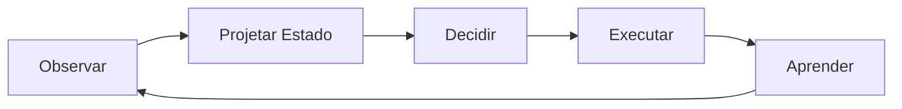

# Arquitetura de Operações Autônomas

## Posicionamento da plataforma

O r-agent2 é uma **Plataforma de Operações Autônomas para negócios de serviços**.

Essa definição complementa, e não substitui, os pilares já existentes da plataforma. O objetivo desta arquitetura é deixar explícito como a plataforma:

- observa eventos
- projeta estado operacional
- decide a próxima melhor ação
- executa automações
- aprende com resultados

## Closed-loop operational system

O loop operacional central da plataforma é:

`Observar -> Projetar Estado -> Decidir -> Executar -> Aprender`

Esse loop convive com o ciclo operacional canônico já documentado:

`Evento -> Sinal -> Recomendação -> Decisão -> Ação / Ação Rápida / Playbook -> Resultado -> Memória Operacional`

Leitura integrada:

- `Observar` corresponde à captura de eventos e fatos operacionais
- `Projetar Estado` corresponde às projeções de estado, sinais e contexto decisório
- `Decidir` corresponde à determinação da Próxima Melhor Ação
- `Executar` corresponde à orquestração via runtime, flows, BPMN e serviços
- `Aprender` corresponde a resultados, memória operacional e feedback de decisão

## Autonomous Operations Architecture

## Tabela de mapeamento entre arquitetura e código

| Camada | Implementação atual no projeto |
| --- | --- |
| Event Backbone | `eventLedgerService`, `OperationalEventBus`, `OperationalEventsService`, `OperationalEventWriter` |
| Operational State | `OCCOperationalStateRepository`, `operational-state`, `contextBuilder`, `conversationContextService` |
| Operational Brain | `SignalDetectionService`, `RecommendationEngine`, `OperationalDecisionEngine`, `autonomous-scheduling`, `playbooks` |
| Automation Runtime | `PlaybookRunner`, `QuickActionExecutor`, `flowEventTriggerService`, `messageProcessor`, `voiceRuntimeService` |
| AI Layer | `conversationContextService`, `conversationMemoryService`, `faqGeneratorService`, páginas e fluxos com RAG/copiloto |
| Operational Memory | `OperationalMemoryService`, `OperationalOutcomeEngine` |

### 1. Event Backbone

O r-agent2 é orientado a eventos. Eventos são a base para automação, métricas, projeções de estado e decisões.

Exemplos de eventos:

- `conversation.received`
- `ticket.created`
- `booking.cancelled`
- `booking.gap_detected`
- `contact.reactivation_due`
- `sla.risk_detected`
- `order.delayed`

Responsabilidades do backbone de eventos:

- normalizar semântica entre domínios
- preservar timestamp, origem e rastreabilidade
- alimentar projeções operacionais e analytics
- disparar automações e avaliações de decisão

### 2. Operational State Projections

As projeções de estado operacional consolidam o contexto de negócio derivado dos eventos.

Exemplos de projeção:

- estado do contato
- estado do ticket
- estado da agenda
- estado da fila
- estado da oportunidade
- estado do atendimento
- estado operacional por profissional
- estado operacional por unidade

Responsabilidades:

- transformar eventos brutos em contexto utilizável
- manter snapshots operacionais consultáveis
- expor contexto explicável para recomendações e decisões

### 3. Operational Decision Layer

A camada de decisão operacional determina a **Próxima Melhor Ação (Next Best Action)**.

Exemplos de decisões:

- priorização de ticket
- sugestão de resposta
- reativação de contato
- oferta de horário
- redistribuição de fila
- otimização de agenda
- ações de revenue

Responsabilidades:

- combinar projeções operacionais, políticas e IA
- decidir entre ação, ação rápida, playbook ou no-op
- registrar decisões explícitas e auditáveis

## Operational Brain

O **Operational Brain** é a leitura integrada da camada que transforma observação e estado operacional em **Next Best Operational Action**.

Essa camada não é um único arquivo. Ela é a composição dos componentes que:

- detectam sinais operacionais
- geram recomendações
- priorizam e escolhem decisões
- especializam política por domínio
- conectam a decisão ao runtime de execução

Componentes envolvidos:

- `OperationalDecisionEngine`
- `RecommendationEngine`
- `SignalDetectionService`
- `AutonomousScheduling`
- `Playbooks`

Leitura prática:

- `SignalDetectionService` detecta relevância operacional
- `RecommendationEngine` transforma sinais em opções acionáveis
- `OperationalDecisionEngine` explicita prioridade, modo de ação e decisão
- `AutonomousScheduling` é um cérebro especializado para agendamento
- `Playbooks` materializam estratégias operacionais recorrentes que a decisão pode acionar

### 4. Automation Runtime

O runtime de automação executa as decisões operacionais usando:

- Flow Editor
- BPMN
- automações
- triggers
- integrações

Modelo de execução:

`Decision Layer decide`
`↓`
`Flow / BPMN orquestra`
`↓`
`Serviços executam`

Responsabilidades:

- transformar decisões em execução real
- orquestrar execução síncrona e assíncrona
- aplicar retry, backoff e guardrails
- produzir evidência operacional observável

### 5. AI Layer

A camada de IA amplia a capacidade operacional da plataforma.

Capacidades:

- classificação
- RAG
- copiloto
- geração de resposta
- recomendação
- previsão

A IA usa contexto vindo de:

- dados de CRM
- conversas
- tickets
- agenda
- métricas operacionais

Responsabilidades:

- enriquecer decisões e priorização
- aumentar qualidade de resposta e recomendação
- oferecer suporte explicável sob governança operacional

### 6. Operational Core

O núcleo operacional reúne os domínios centrais da plataforma:

- CRM operacional
- tickets
- conversations
- scheduling
- queues
- orders
- tasks

Todas as operações nesses domínios geram eventos de volta para o backbone, fechando o loop operacional.

### 7. Vertical Templates

Os templates verticais especializam comportamento sem alterar o core.

Templates oficiais:

- beauty
- fitness
- food
- services

Cada template define:

- políticas
- pesos
- automações
- dashboards
- métricas

Esses templates permitem especialização vertical sem alterar o core da plataforma. A plataforma permanece única; o comportamento operacional é adaptado por preset, política e runtime default.

## Autonomous Scheduling

**Autonomous Scheduling** é o primeiro domínio operacional autônomo implementado.

Fluxo:

`booking.cancelled`
`↓`
`gap detection`
`↓`
`candidate generation`
`↓`
`ranking`
`↓`
`campaign / offer`
`↓`
`booking confirmed`

Esse fluxo representa um caso real de **Closed-Loop Autonomous Operations**:

- um evento de operação é observado
- o estado operacional da agenda é projetado
- a camada de decisão escolhe candidatos e estratégia
- o runtime executa campanha, oferta e automação
- o resultado realimenta memória, métricas e políticas futuras

Leitura pelas camadas da plataforma:

- `Event Backbone`: `booking.cancelled`
- `Operational State`: detecção de gap e contexto de agenda
- `Operational Brain`: ranking de candidatos e escolha de estratégia
- `Automation Runtime`: campanha, convite, oferta e follow-up
- `Operational Memory`: resultado final e aprendizado para ciclos futuros

## Relação com os pilares existentes

Mapeamento entre os pilares atuais e a nova arquitetura:

- `Automation Platform` -> `Automation Runtime`
- `CRM Operacional` -> `Operational Core`
- `Contact Center` -> `Operational Core`
- `Scheduling` -> `Operational Core`
- `Autonomous Operations` -> `Operational Decision Layer`
- `Predictive Operations` -> `AI Layer`
- `Revenue Engine` -> `Operational Decision Layer + AI Layer`
- `Physical Channels` -> `Operational Core`
- `Vertical Templates` -> `Vertical Templates`

Esse mapeamento preserva a estrutura atual da documentação e torna a leitura arquitetural mais explícita.

## Definição consolidada

Após esta consolidação, o r-agent2 deve ser lido como uma plataforma que combina:

- CRM operacional
- Contact Center omnichannel
- automação
- IA
- operações de serviço
- decisões assistidas e autônomas
- templates verticais

Em síntese:

**r-agent2 é uma Autonomous Operations Platform.**

## How to Align Code with Architecture

Novos módulos e refatorações devem seguir, sempre que possível, o fluxo:

`event -> state projection -> decision -> action -> outcome`

Regras de alinhamento:

- introduzir um fato operacional explícito antes de introduzir uma automação nova
- projetar estado consultável antes de misturar regra de decisão com execução
- manter a decisão explicável e auditável
- delegar execução para runtime, quick actions, playbooks, flows ou serviços
- registrar outcome sempre que houver execução operacional relevante
- alimentar memória operacional quando houver outcome, decisão ou feedback útil

Esse padrão ajuda a manter o projeto coerente com a visão de **Autonomous Operations Platform** e evita a criação de fluxos paralelos difíceis de observar, operar e evoluir.
