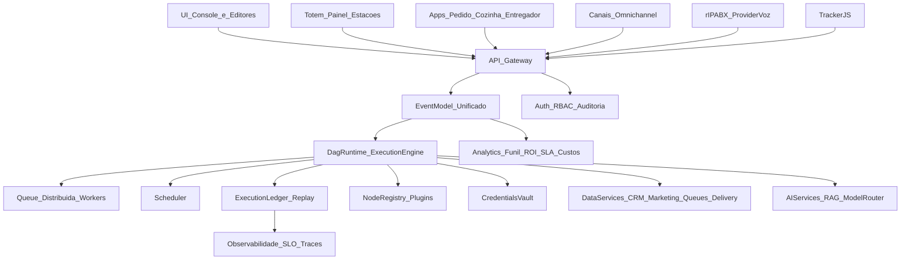
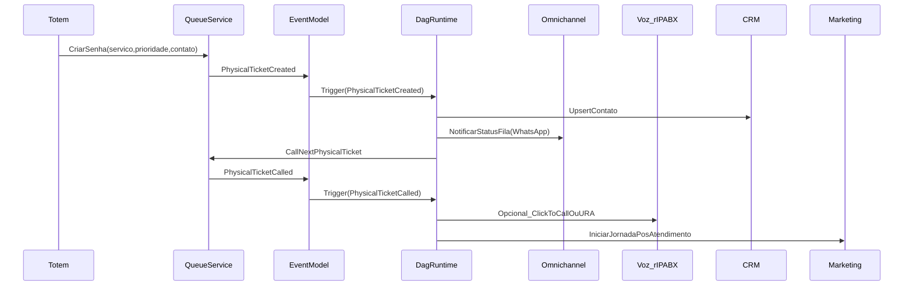

# Arquitetura técnica — visão de módulos (SaaS enterprise)

## 1) Objetivo

Documentar a arquitetura-alvo da plataforma unificada (8 pilares) e como ela se materializa em módulos: editor visual, runtime DAG, registry de nodes/plugins, execução, filas/workers, scheduler, credenciais, serviços de IA, CRM operacional integrado, r-IPABX, filas físicas (totem/painel/senha), módulo de pedidos/delivery (marketplace/logística) e camada SaaS multi-tenant.

Benchmarks inspiradores citados explicitamente:
- **n8n** (automação)
- **RD Station** (marketing)
- **HubSpot/Zendesk** (estrutura CRM + operação de relacionamento)
- **BLIP/Huggy/Zenvia** (atendimento)
- **Twilio Flex/Talkdesk/Five9** (voz/contact center)
- **LangFlow/Flowise** (orquestração de IA)
- **Qminder/QLess/Waitwhile/Skiplino** (filas físicas)
- **iFood/Uber Eats/Rappi/DoorDash** (delivery/marketplace)

## 2) Visão em camadas

## 3) Componentes principais

### 3.1) Editor visual (Flow Builder)
- Responsável por: modelar o DAG, validar, versionar, publicar e instalar templates.
- Requisitos enterprise:
  - diffs entre versões, controle de mudanças, permissões por pasta/projeto.

### 3.2) Runtime DAG (Execution Engine) — inspirado em n8n
- Responsável por: compilar, executar, orquestrar e observar flows.
- Requisitos:
  - execução por nó (inputs/outputs), idempotência/deduplicação, retries, timeouts, paralelismo, backpressure.
- Operação:
  - histórico e replay; correlação via `executionId`/`correlationId`.

### 3.3) Node registry / plugins (Marketplace-ready)
- Responsável por: catálogo de nodes (ações, triggers, integrações) com versionamento e governança.
- Requisitos:
  - assinatura/verificação, permissões declarativas, sandbox, compatibilidade por versão.

### 3.4) Queue + workers (dois domínios)

**(A) Queue de execução do DAG (core)**  
- Fila distribuída para execuções/steps do runtime (prioridade, DLQ, escalabilidade).

**(B) Filas operacionais de atendimento e mensagens (produto)**  
- Filas e roteamento (tickets, SLAs, assignment worker).  
- Outbound queue para envio confiável (retry/backoff) em canais.

> Importante: são filas com finalidades diferentes; a documentação de “gaps” já enfatiza essa separação.

### 3.5) Scheduler
- Cron/timezone, janelas, reprocessamento e execução garantida.
- Integra com o runtime e com o event model (scheduler também gera eventos).

### 3.6) Credentials vault
- Armazena credenciais de integrações (canais, email, CRM, voz, IA) por tenant, com RBAC e auditoria.
- Requisitos:
  - criptografia, rotação, escopo (tenant/projeto/flow/node), trilha de acesso.

### 3.7) IA services (LangFlow/Flowise-like)
- **RAG** (indexação e busca) + **contexto cognitivo do tenant** + nodes de IA reutilizáveis.
- Requisitos:
  - governança (custo, privacidade/PII, avaliação), roteamento de modelos custo/qualidade.

### 3.8) Atendimento omnichannel (BLIP/Huggy/Zenvia-like)
- Gateway omnichannel normaliza mensagens e mantém histórico idempotente.
- Camada de operação humana: tickets, filas, handover bot↔humano, SLA e analytics.

### 3.9) Voz / Contact Center (Twilio Flex/Talkdesk/Five9-like)
- Provider (ex.: **r-IPABX**) deve emitir/consumir eventos padronizados:
  - `CallRinging/Answered/Ended`, `DTMF`, `RecordingReady`, etc.
- URA visual vira um conjunto de nodes do DAG (menus, horários, roteamento).

### 3.10) Filas físicas / Fast service (Qminder/Waitwhile-like)
- Totem/kiosk, painel/TV e estações geram eventos e consomem comandos do DAG.
- Métricas de espera e throughput entram no analytics e podem acionar automações (ex.: “SLA físico em risco”).

### 3.11) Pedidos/Delivery (iFood/Uber Eats/Rappi/DoorDash-like)
- Lifecycle do pedido + produção/fulfillment + logística (despacho/tracking) geram eventos padronizados.
- Operação se integra a atendimento (incidentes) e marketing (pós-venda/recompra).
- SLAs de entrega e custos (logística, suporte, refund) entram no analytics.

### 3.12) SaaS multi-tenant (base enterprise)
- Multi-tenant, RBAC, rate limiting, auditoria, planos/limites, super-admin, onboarding.
- Requisitos de endurecimento:
  - isolamento em caches, workers e webhooks; testes de isolamento; observabilidade por tenant.

### 3.13) CRM Operacional Integrado (novo pilar transversal)
- **Princípio**: CRM orientado a eventos como fonte de verdade, conectado ao `event_ledger` e ao runtime DAG.
- **Escopo MVP (entidades obrigatórias)**:
  - `Conta`, `Contato`, `Lead`, `Oportunidade`, `Pipeline`, `Atividade`, `Evento`.
- **Capacidades obrigatórias**:
  - histórico unificado (mensagens, chamadas, tickets, bots, eventos)
  - pipeline acionado por eventos reais do negócio
  - automação nativa por status/movimentação
  - SLA comercial e operacional
  - IA integrada ao fluxo (classificação, sugestão, roteamento)
- **Relação com arquitetura existente**:
  - sem duplicar lógica de atendimento; CRM consome/publica eventos e compõe com os serviços existentes
  - integrações diretas com automações (triggers/handlers), marketing operacional e voz/CCaaS
  - consistência por idempotência, trilha de auditoria e isolamento multi-tenant desde a modelagem inicial

## 4) Fluxos end-to-end (exemplo unificado)

## 5) Observabilidade e governança (não-funcionais)

- **SLOs** por runtime, canais, voz e filas físicas (latência, falhas, throughput).
- **Auditoria** por ação relevante (flows, credenciais, chamadas, tickets, senhas).
- **Retenção** configurável (execuções, gravações, eventos do tracker, histórico).
- **Custos**: rastrear custos por tenant (execuções, eventos, voz, IA, storage).

