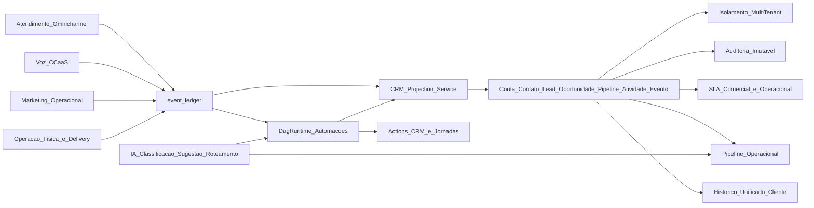

# Pilar CRM Operacional Integrado

## 1) Definição formal

**Benchmark conceitual oficial**: Sistema Operacional do Relacionamento com o Cliente.

**Diretriz estratégica**:
> O CRM do R-Agent2 não é um módulo isolado.  
> Ele é a camada que conecta atendimento, automação, marketing e operação em torno do cliente.

### O que este CRM É
- Uma camada operacional orientada a eventos reais do negócio.
- Um modelo unificado de relacionamento com entidades e histórico completo por cliente.
- Um motor de decisões no fluxo (pipeline, SLA, ownership, priorização e automação).

### O que este CRM NÃO É
- Não é cópia literal de CRM comercial tradicional.
- Não é CRM puramente comercial focado só em cadastro e funil estático.
- Não é Salesforce-like monolítico nem módulo isolado da operação.

## 2) Benchmarks de referência (inspiracionais)

- **HubSpot**: estrutura de CRM (contatos, empresas, negócios, pipeline)
- **Zendesk**: atendimento, tickets, histórico de interações e SLA
- **RD Station**: marketing automation, jornadas, origem de leads
- **n8n**: automação visual, DAG, execuções, eventos
- **Plataformas CCaaS**: voz, filas, agentes, SLA de chamadas

> Esses benchmarks são referências por domínio. Não devem ser copiados integralmente.

## 3) Escopo MVP (obrigatório)

### Entidades
- `Conta`
- `Contato`
- `Lead`
- `Oportunidade`
- `Pipeline`
- `Atividade`
- `Evento`

### Capacidades
- Histórico unificado: mensagens, chamadas, tickets, bots e eventos
- Pipeline acionado por eventos reais do negócio
- Automação nativa por status e movimentação
- SLA comercial e operacional
- IA integrada ao fluxo (classificação, sugestão e roteamento)

## 4) Roadmap do pilar (NOW / NEXT / LATER)

### NOW (0–3 meses)
- Definir entidades base do CRM
- Integrar CRM ao atendimento e à automação
- Criar histórico unificado do cliente

### NEXT (3–12 meses)
- Implementar pipeline visual
- Implementar ownership de leads e contas
- Entregar métricas básicas de CRM
- Integrar CRM ao marketing operacional

### LATER (12–24 meses)
- Aplicar IA ao CRM
- Gerar recomendações automáticas
- Implementar previsão e otimização operacional

## 5) Orientação técnica de implementação

### 5.1 Modelos de dados CRM
- Base relacional por tenant para entidades centrais (`crm_accounts`, `crm_contacts`, `crm_leads`, `crm_opportunities`, `crm_pipelines`, `crm_activities`).
- Modelo de estágios de pipeline versionável por tenant/unidade.
- Chaves de correlação (`correlation_id`, `subject_id`) para vincular atendimento/voz/marketing/operação.

### 5.2 Relação direta com `event_ledger`
- `event_ledger` é a fonte de verdade para transições e fatos operacionais.
- Projeções de CRM são derivadas de eventos canônicos, sem lógica duplicada de domínio.
- Reprocessamento idempotente para reconstruir estado CRM quando necessário.

### 5.3 Integração com automações existentes
- Triggers por evento CRM no runtime DAG (mudança de estágio, SLA em risco, owner alterado).
- Actions de CRM no DAG (criar/atualizar entidade, criar atividade, mover oportunidade).
- Reuso de filas/workers/scheduler já existentes.

### 5.4 Pontos de extensão para marketing e voz
- Marketing: origem de lead, jornada ativa, conversão por campanha, supressão por estado operacional.
- Voz/CCaaS: ligação e status de chamada compondo timeline e SLA.
- Atendimento: ticket/conversa mantendo relação 1:1 com contexto operacional do cliente.

### 5.5 Consistência, auditoria e multi-tenancy
- Multi-tenant by design em todas as entidades e projeções.
- Idempotência por evento e versionamento otimista em mudanças de estágio.
- Auditoria imutável de alterações críticas (owner, estágio, SLA, automações disparadas).
- Regras de segurança e RBAC alinhadas à base SaaS já existente.

## 6) Backlog inicial de implementação (proposto)

### B0 — Fundação de domínio CRM
- Criar migrations/models das entidades MVP com `tenant_id` obrigatório.
- Definir contratos de eventos CRM (`CrmLeadCreated`, `CrmOpportunityStageChanged`, `CrmSlaRiskRaised`, etc.).
- Criar serviços de projeção CRM a partir do `event_ledger`.

### B1 — Histórico unificado e timeline
- Implementar timeline consolidada por cliente (tickets + mensagens + chamadas + eventos).
- Criar endpoint de leitura unificada para console operacional.
- Garantir paginação, filtros por período e trilha de auditoria.

### B2 — Pipeline operacional por eventos
- Implementar CRUD de pipeline e estágios por tenant.
- Implementar movimentação de oportunidade via evento (não por escrita direta sem trilha).
- Acoplar SLA comercial/operacional por estágio.

### B3 — Automação e integrações
- Expor triggers/actions de CRM no runtime DAG.
- Integrar com atendimento (handover, ticket status), marketing (jornada, origem) e voz (call events).
- Adicionar métricas básicas (conversão, aging, SLA, throughput de atividades).

### B4 — IA no fluxo CRM
- Classificação automática de lead/oportunidade por contexto.
- Sugestões de próxima melhor ação para agente/supervisor.
- Roteamento assistido por IA com guardrails e auditoria.

## 7) Diagrama conceitual (CRM integrado)

## 8) Posicionamento final da plataforma

**Não somos apenas um CRM.**  
**Somos o sistema operacional do relacionamento com o cliente.**
