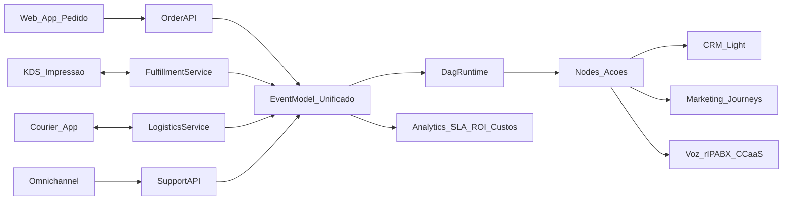

# Delivery / Marketplace de pedidos (iFood / Uber Eats / Rappi / DoorDash) — visão de produto e arquitetura

## 1) Por que delivery é core (não um “canal”)

O eixo de **delivery/marketplace** não é apenas “receber um pedido”. Ele é uma operação com:

- jornada do cliente (conversão, reengajamento, pós-venda),
- coordenação interna (cozinha/produção, expedição, cancelamentos),
- logística (despacho, tracking, SLA de entrega),
- atendimento (suporte em tempo real por WhatsApp/voz),
- mensuração (custo, margem, qualidade e tempo total).

Benchmarks de referência (explicitamente):
- **iFood**, **Uber Eats**, **Rappi**, **DoorDash**.

## 2) Capabilities esperadas (baseline do “iFood-like”)

### Pedido (order lifecycle)
- Criação do pedido (carrinho, itens, observações)
- Pagamento (quando aplicável) e antifraude (quando aplicável)
- Estados do pedido em tempo real:
  - `created` → `confirmed` → `preparing` → `ready` → `dispatched` → `delivered`
  - `cancelled` / `refunded` (quando aplicável)

### Produção (kitchen/fulfillment)
- Fila de preparo (prioridade, SLA, batching)
- Estações (cozinha, expedição) e handoffs
- Impressão/KDS (quando aplicável)

### Entrega (logística)
- Despacho de entregador (próprio ou parceiro)
- Tracking (posição, status) e ETA
- Evidências (foto/assinatura) e ocorrências

### Notificações e suporte
- Notificações proativas (pedido confirmado, saiu para entrega, atraso)
- Atendimento omnichannel para incidentes (troca, atraso, item faltante)
- Escalonamento para voz (quando necessário)

### Qualidade e pós-venda
- Avaliação/NPS
- Recuperação de cliente (cupons, reentrega, reembolso)
- Segmentação e reengajamento (marketing)

### SLAs e métricas (operacionais e de negócio)
- Tempo total `order_to_delivery`
- Tempo de preparo `order_to_ready`
- Tempo de despacho `ready_to_dispatched`
- Tempo de entrega `dispatched_to_delivered`
- Cancelamento, refund, itens faltantes
- Margem e custos (taxas, logística, suporte)

## 3) Como delivery vira nodes e eventos no DAG

### Eventos (triggers) do mundo “order+logistics”
- `OrderCreated`
- `OrderConfirmed`
- `OrderPreparing`
- `OrderReady`
- `CourierDispatched`
- `OrderOutForDelivery`
- `OrderDelivered`
- `OrderCancelled`
- `DeliverySLARisk` (ex.: ETA estourando)
- `SupportIncidentOpened` (cliente reclamou)

### Nodes (ações) do DAG
- **Pedido**:
  - `CreateOrder`, `ConfirmOrder`, `CancelOrder`, `RefundOrder` (quando aplicável)
- **Produção**:
  - `EnqueueKitchenJob`, `UpdateKitchenStatus`, `PrintKitchenTicket`
- **Logística**:
  - `DispatchCourier`, `UpdateCourierStatus`, `RequestCourierProof`
- **Comunicação**:
  - `NotifyCustomer(WhatsApp/SMS/Email/Push)`, `OpenSupportTicket`, `EscalateToVoice`
- **Dados/CRM/Marketing**:
  - `CRMUpsert`, `LeadScoreUpdate`, `JourneyStart`, `CouponIssue`, `FeedbackRequest`
- **IA**:
  - `ClassifyIncident`, `PredictETA`, `SuggestCompensation`

## 4) Arquitetura-alvo (alto nível)

## 5) Modelo de dados (conceitual)

Entidades mínimas recomendadas (conceitual):

- `Merchant`/`Store` (unidade)
- `CatalogItem`/`Menu` (itens)
- `Order` (pedido) + `OrderItem`
- `Payment` (opcional)
- `FulfillmentJob` (preparo/expedição)
- `Courier` (entregador) + `DeliveryAssignment`
- `DeliveryEvent` (ledger de eventos)
- `SupportIncident` (vínculo com ticket/conversa)

Campos críticos de integração:
- `tenant_key`
- `store_id` (multi-unidade)
- `order_id` e `correlation_id` (ligar com ticket, execução do DAG e identidade do cliente)
- `customer_identity` (telefone/whatsapp/email — com consentimento)

## 6) Integrações end-to-end (exemplos)

### Exemplo A — Restaurante/pizzaria (balcão + delivery próprio)
Pedido criado → DAG valida área de entrega → enfileira preparo → notifica cliente → despacha entregador → tracking → entrega → solicita avaliação → inicia jornada de recompra.

### Exemplo B — Marketplace híbrido (agregadores + próprio)
Pedido vindo de agregador → normaliza order events → DAG aplica regras de SLA/estoque → suporte omnichannel para incidentes → reembolso/cupom automatizado.

## 7) Requisitos enterprise e riscos

- **Confiabilidade e idempotência**: pedidos e eventos podem ser reenviados; exigir dedupe (orderId + eventId).
- **Fraude/chargeback** (quando há pagamento): políticas, logs e auditoria.
- **Custos**: tracking, notificações e suporte; limites por tenant e observabilidade.
- **Privacidade (LGPD)**: consentimento para notificações e retenção configurável.

