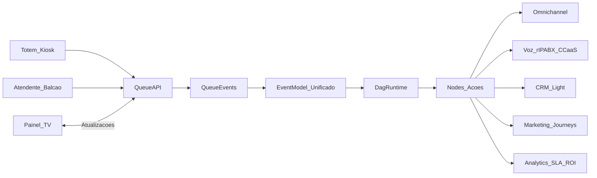

# Filas físicas / Fast service (totem, senha e painel) — visão de produto e arquitetura

## 1) Por que filas físicas são core (não um “add-on”)

O eixo de **filas físicas** (fastfood, clínica, balcão) não é apenas “um módulo de UI”. Ele é um **gerador de eventos** e uma **fonte de demanda** que precisa ser orquestrada junto com:

- atendimento omnichannel (avisos e follow-ups),
- voz (chamadas internas/URA quando aplicável),
- CRM (histórico e preferências),
- marketing (segmentação e reengajamento),
- IA (triagem e priorização),
- automação (DAG) como motor de execução.

Benchmarks de referência (explicitamente):
- **Qminder**, **QLess**, **Waitwhile**, **Skiplino**: gestão de filas, totem, painel, métricas e priorização.

## 2) Capabilities esperadas (baseline do “Qminder-like”)

### Emissão de senha (entrada na fila)
- Totem/kiosk touch (tablet/desktop)
- QR code (auto check-in)
- Entrada manual pelo atendente/balcão
- Impressão opcional / número exibível
- Captura opcional de contato (telefone/WhatsApp) com consentimento

### Tipos de fila e roteamento
- Filas por serviço (ex.: “Retirada”, “Caixa”, “Triagem”, “Consulta”)
- Regras por horário e capacidade
- Multi-locais (lojas/unidades)

### Priorização
- Preferencial (idoso/gestante/PCD)
- Agendamento vs. walk-in
- Triagem (ex.: gravidade/serviço)
- SLA físico (tempo de espera alvo)

### Painel de chamada (TV/display)
- Exibir número/senha + guichê/estação
- Múltiplos painéis por área
- Áudio/voz (opcional)
- Histórico de chamadas

### Estações (guichês/atendentes)
- “Chamar próximo”
- Pular, pausar, transferir
- Finalizar atendimento (com motivo/categoria)

### Métricas
- Tempo médio de espera
- Throughput (atendimentos/hora)
- Abandono (no-show/desistência)
- Produtividade por estação/operador
- Picos por faixa de horário

## 3) Como filas físicas viram nodes e eventos no DAG

### Eventos (triggers) do mundo físico
- `PhysicalTicketCreated`
- `PhysicalQueueJoined`
- `PhysicalTicketCalled`
- `PhysicalServiceStarted`
- `PhysicalServiceCompleted`
- `PhysicalTicketAbandoned`
- `PhysicalSLARisk` (espera excedeu meta)

### Nodes (ações) que o DAG pode executar
- `CreatePhysicalTicket` (criar senha via totem/atendente)
- `SetPhysicalTicketPriority`
- `CallNextPhysicalTicket`
- `TransferPhysicalTicket` (fila A → fila B)
- `UpdatePanelDisplay` (painel/TV)
- `NotifyCustomer` (WhatsApp/SMS/email com status da fila)
- `CreateOrUpdateCRMContact`
- `StartOmnichannelConversation` (abrir ticket digital a partir de um ticket físico)
- `CreatePostServiceJourney` (ex.: NPS, cupom, reengajamento)

## 4) Arquitetura-alvo (alto nível)

## 5) Modelo de dados (conceitual)

Entidades mínimas recomendadas para filas físicas (conceitual):

- `PhysicalLocation` (unidade/loja)
- `PhysicalQueue` (tipo de fila, regras, prioridade)
- `PhysicalStation` (guichê/estação de atendimento)
- `PhysicalTicket` (senha; estado: waiting/called/in_service/done/abandoned)
- `PhysicalEvent` (ledger de eventos com timestamps)

Campos críticos para integração com a plataforma:
- `tenant_key` (SaaS)
- `location_id` (multi-unidade)
- `external_id` (quando integrado a hardware/terceiros)
- `customer_identity` (quando houver telefone/CPF/email, com consentimento)
- `correlation_id` (para ligar à execução do DAG/ticket digital/chamada)

## 6) Integrações end-to-end (exemplos)

### Exemplo A — Fastfood
Totem → senha criada → DAG calcula prioridade (ex.: retiradas) → painel chama → atendimento finaliza → DAG envia cupom → atualiza CRM → cria segmento “frequente” → jornada marketing.

### Exemplo B — Clínica (triagem)
Totem/check-in → DAG roda triagem com IA → define fila e prioridade → chama próximo → ao finalizar, DAG agenda retorno e dispara lembretes.

## 7) Requisitos enterprise e riscos

- **Fraude e abuso**: limitar criação de senhas por dispositivo/horário; validações.
- **Offline/instabilidade**: totem precisa modo degradado (cache local) e ressincronização.
- **Privacidade (LGPD)**: consentimento explícito para contato; retenção configurável.
- **Observabilidade**: auditoria de chamadas de painel/estação e métricas por unidade.

