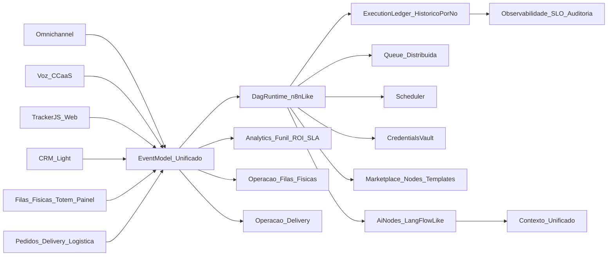

# Roadmap 3–5 anos (0–60 meses) — versão operacional (Fev/2026 - 05/02)

Este documento foi reestruturado para um formato **Now/Next/Later** (horizontes de meses) e mantém, ao final, o detalhamento **por fases de maturidade** (referência 3–5 anos).

> **Fonte única do backlog (“o que falta”)**: `docs/O_QUE_FALTA.md` (operacional, priorizado e com DoD/gates).

## Links rápidos

- **Roadmap (atalho)**: `ROADMAP.md`
- **Inventário de endpoints (codebase)**: `API_ENDPOINTS_CODEBASE.md`
- **Inventário completo (api/**/*.js)**: `API_ENDPOINTS_CODEBASE_FULL.md`
- **Endpoints no codebase não citados nos roadmaps**: `API_ENDPOINTS_UNDOCUMENTED.md`
- **Endpoints exatos não citados**: `API_ENDPOINTS_UNDOCUMENTED_EXACT.md`

## 1) Visão geral da plataforma (8 pilares)

Esta plataforma converge **oito** categorias de benchmarks em **um único produto SaaS multi-tenant enterprise**:

- **CORE de automação** (inspirado em **n8n**): runtime DAG, nodes, execuções por nó, replay, scheduler, fila distribuída, credenciais, versionamento, subflows, templates e marketplace.
- **Marketing automation** (inspirado em **RD Station**): forms, landing pages, tracker JS, scoring, jornadas, email marketing, funil visual, analytics e ROI.
- **CRM Operacional Integrado** (benchmark conceitual: **Sistema Operacional do Relacionamento com o Cliente**, inspirado em **HubSpot/Zendesk/RD Station/n8n/CCaaS**): entidades CRM orientadas a eventos, histórico unificado, pipeline acionado por eventos reais do negócio e automação nativa por status/movimentação.
- **Atendimento omnichannel** (inspirado em **BLIP/Huggy/Zenvia/ChatPro**): bot + humano, filas, SLA, distribuição inteligente, histórico completo do cliente.
- **Voz/contact center** (inspirado em **Twilio Flex/Talkdesk/Five9**): URA visual, filas de voz, transferências, gravação, click-to-call e eventos de chamada como triggers.
- **IA nativa** (inspirado em **LangFlow/Flowise**): nodes reutilizáveis, classificação, priorização, sugestão de ações, enriquecimento de dados, contexto unificado e governança.
- **Filas físicas / fast service** (inspirado em **Qminder / QLess / Waitwhile / Skiplino**): totem, senha, painel de chamada, estações, priorização e métricas de espera/throughput integradas ao DAG.
- **Delivery / marketplace de pedidos** (inspirado em **iFood / Uber Eats / Rappi / DoorDash**): criação de pedido, status em tempo real, preparo/expedição, despacho e tracking, notificações, avaliação e SLA de entrega integrados ao DAG.

### Arquitetura-alvo (alto nível)

## 2) Status atual (Fev/2026)

### 2.1) Concluído (baseline/MVP já disponível no repo)

- **Core de eventos + ledger (primeiro corte, DB-first)**:
  - Event model canônico v1: `api/events/eventModelV1.js` (physical/order/delivery/pbx + SLA + scheduler + suporte).
  - Event ledger append-only: migration `api/db/migrations/20260204020000-create-event-ledger.js` + model `api/db/models/EventLedger.js` + serviço `api/services/eventLedgerService.js`.
  - Retenção mínima (prune): `api/services/pruneEventLedgerService.js` (por `EVENT_LEDGER_RETENTION_DAYS`).
  - PBX: trigger DB-level em `pbx_cdr` emitindo `PbxCdrIngested` no `event_ledger` (best-effort).
  - Dispatcher v1 (parcial) para webhooks: `api/services/eventLedgerTriggerDispatcher.js` + cursor `event_dispatch_state` (migrations `api/db/migrations/20260204033000-event-dispatch-state-and-schedule.js` e `api/db/migrations/20260204034000-event-dispatch-state-add-last-event-id.js`).
  - Trigger de flows por evento com modo estrito (retry/DLQ): `api/services/flowEventTriggerService.js` (mapeamento via `metadata.eventTriggers`).

- **Execution Queue + Scheduler v1 (DB-first, interno)**:
  - Tabelas: `execution_jobs` + `schedules` em `api/db/migrations/20260204021000-create-exec-jobs-and-schedules.js`.
  - Worker: `api/services/executionQueueService.js` (claim com `SKIP LOCKED`, retry/backoff best-effort).
  - Scheduler: `api/services/schedulerService.js` (interval-based) + evento `ScheduledTriggerFired`.
  - Hooks operacionais iniciais: scanner de SLA em `api/services/opsSlaService.js` emitindo `DeliverySLARisk` e `PhysicalSLARisk`.
  - Execution ledger por nó (v1, DB-first): `flow_executions` + `node_executions` (migration `api/db/migrations/20260204031000-create-flow-execution-ledger.js`) + serviço `api/services/flowExecutionLedgerService.js`.
  - Quotas, DLQ e métricas operacionais: quotas por tenant (rate-limit), DLQ consultável/reprocessável e métricas em `GET /api/ops/execution-jobs/metrics`, `GET /api/ops/execution-jobs/metrics-by-kind`, `GET /api/ops/execution-jobs/dead` e `POST /api/ops/execution-jobs/retry` + selftest (`executionQueue`).

- **Pedidos + storefront (público por token)**:
  - Backend: `POST /storefront/orders?token=...` e `GET /storefront/orders/:id?token=...` em `api/server.js` (cria pedido e consulta status).
  - Persistência: migrations `api/db/migrations/20260203000002-create-orders.js` e `api/db/migrations/20260203000003-create-deliveries.js`.
  - Domínio: `api/services/orderService.js` (transições de status `created→…→delivered`) + `api/services/deliveryService.js` (delivery best-effort).
  - UI: `frontend/src/pages/StorefrontOrderPage.jsx` e `frontend/src/pages/StorefrontOrderStatusPage.jsx`.
  - Operação interna (autenticado): `GET /orders`, `GET /orders/:id` e `PUT /orders/:id/status` em `api/server.js` + UI `frontend/src/pages/OrdersPage.jsx`, `frontend/src/pages/KitchenPage.jsx`, `frontend/src/pages/DispatchPage.jsx`.
  - Métricas operacionais: `GET /api/orders/metrics` (agregações por `locationId`).
  - Hardening v1: idempotência v1 por `idempotencyKey` (storefront) e propagação de `correlationId` para delivery (best-effort).
  - Incidentes (ponte para omnichannel): `POST /orders/:id/incidents` abre ticket digital básico e emite `SupportIncidentOpened` (best-effort).

- **Filas físicas (totem/painel/estação) — público por token**:
  - Backend: `POST /physical/kiosk/tickets`, `GET /physical/panel/state`, `POST /physical/station/call-next`, `POST /physical/station/finish` em `api/server.js`.
  - Persistência: migrations `api/db/migrations/20260203000004-create-physical-queues.js` e `api/db/migrations/20260203000005-create-physical-tickets.js`.
  - Domínio: `api/services/physicalQueueService.js`.
  - UI: `frontend/src/pages/KioskPage.jsx`, `frontend/src/pages/PanelPage.jsx`, `frontend/src/pages/StationPage.jsx`.
  - Observação: já existe suporte de **biometria** e um modo de **dedupe best-effort** na emissão de senha (para evitar duplicação por re-scan).
  - Operações v1 adicionais (público por token): `POST /physical/station/start`, `POST /physical/station/skip`, `POST /physical/station/transfer` + UI atualizada em `StationPage`.
  - Multi-unidade/multi-fila (admin): `GET/POST /api/physical/queues` (autenticado) com unique por `tenant+location+name`.
  - Sequenciamento robusto: `physical_ticket_sequences` (por `tenant+location+queue+day`) em `api/db/migrations/20260204022000-physical-queues-multiunit-and-sequences.js`.
  - Métricas mínimas (admin): `GET /api/physical/metrics` (agregações básicas do dia).
  - Integração mínima com omnichannel: `POST /physical/station/open-support-ticket` cria ticket digital vinculado à senha física e emite `SupportTicketOpened` (best-effort).

- **Tokens públicos (storefront/kiosk/panel/station)**:
  - Backend: `POST /public-tokens` (com auth) e `GET /public-tokens/resolve?token=...` (público) em `api/server.js`.
  - Persistência: migration `api/db/migrations/20260203000001-create-public-access-tokens.js`.
  - Serviço: `api/services/publicAccessTokenService.js`.
  - Stats de uso: `GET /public-tokens/stats` (por `kind`).
  - Lifecycle (v1): expiração/revogação/rotação/last_used (migration `api/db/migrations/20260204030000-public-access-tokens-lifecycle.js` + service).
  - Admin completo (listar/revogar/rotacionar) + auditoria + rate-limit por token/kind.

- **SaaS enterprise (multi-tenant) — base completa (backend + frontend)**:
  - Multi-tenancy + isolamento: `api/middleware/tenantValidation.js` e docs `IMPLEMENTACAO_SAAS_COMPLETA.md`.
  - RBAC (6 roles) + permissões granulares: `api/services/rbacService.js`.
  - Planos/limites: `api/services/planLimitsService.js`.
  - Auditoria/compliance: `api/services/auditService.js`.
  - Super-admin + onboarding: `api/services/superAdminService.js` e `api/services/onboardingService.js` + páginas no frontend (ver `IMPLEMENTACAO_SAAS_COMPLETA.md`).
  - Rate-limit por tenant: `api/middleware/tenantRateLimit.js`.

- **AI Output Envelope (safe-mode + validação por contrato)**:
  - Especificação: `docs/IA_OUTPUT_ENVELOPE.md`.
  - Schema (AJV): `contracts/ia/ai-output-envelope.schema.json`.
  - Implementação e testes: `engine/ai/aiEnvelope.js` e `tests/unit/aiEnvelope.test.js`.

- **Webhooks/WebSockets/validação de input (base)**:
  - Webhooks customizados: `api/services/webhookService.js`.
  - WebSocket server (real-time por tenant): `api/services/websocketService.js`.
  - Validação de inputs: `api/utils/inputValidator.js`.
  - Resumo do pacote (documentação interna): `IMPLEMENTACOES_MELHORIAS.md`.

- **PBX v1 (Postgres + Asterisk Realtime) — configuração básica**:
  - Camada produto (fonte de verdade): migration `api/db/migrations/20260203011000-pbx-product-core.js` (extensions/trunks/routes/queues/members/call_rules/config_versions).
  - Realtime core (Asterisk): migration `api/db/migrations/20260203010000-pbx-realtime-core.js` (extensions + ps_* + filas realtime).
  - Domínios PBX/CC adicionais (migração do menu legado): migration `api/db/migrations/20260204010000-pbx-cc-menu-domains.js` (dids, carriers, categorias, bloqueios, áudios, gravações, CDR, campanhas etc.).
  - Compatibilidade CDR (Asterisk `cdr_adaptive_odbc`): migration `api/db/migrations/20260204011000-pbx-cdr-asterisk-adaptive.js`.
  - **Call events v0 (estado + schedule)**: migration `api/db/migrations/20260204035000-pbx-call-events-state-and-schedule.js` + serviço `api/services/pbx/pbxCallEventsService.js`.
  - API: rotas `GET/POST /api/pbx/*` em `api/server.js` (extensions, trunks, routes, queues, dialplan preview/apply, queue-members, audio-assets, recordings).
  - UI: `frontend/src/pages/PbxPage.jsx` (CRUD básico no Postgres).
  - Porte legado (contrato inicial): `docs/PBX_LEGACY_PORTING.md` e `docs/PBX_V1_INVENTORY.md` (health/inventory/ramais via XML, estratégia gradual).
  - Apply pipeline com trilha mínima: `POST /api/pbx/dialplan/apply` passa a registrar versões `applied/failed` em `pbx_config_versions` (signature do dialplan).
  - **Provisionamento de ramais v1.1 (Grandstream/Avaya) acoplado ao cadastro**:
    - Payload de provisioning no `POST /api/pbx/extensions` (persistido em `pbx_extensions.endpoint_options.provisioning`).
    - Endpoint público: `GET /provision/<tenantKey>/<vendor>/<mac>` (ou com token `GET /provision/<tenantKey>/<token>/<vendor>/<mac>` quando `PROVISIONING_PUBLIC_TOKEN` está definido).
    - Implementação: `api/services/pbx/pbxProvisioningService.js` + `api/services/pbx/pbxExtensionsService.js`.
    - Documentação: `docs/PBX_PROVISIONING_GRANDSTREAM_AVAYA.md`.
    - Templates por vendor/model/firmware, token por tenant, sanity checks (MAC duplicado, senha fraca, ramal inativo) e bulk (`/api/pbx/extensions/bulk`).
  - UI/ops: rotação de token de provisioning e provisionamento em lote (frontend).

- **Selftest read-only (health executivo)**:
  - Endpoint: `GET /health/selftest` (ou `GET /selftest`) em `api/server.js`.
  - Serviço: `api/services/selftestService.js` (checks DB/Redis/RAG sem efeitos colaterais).

- **Validação estrutural de fluxos de voz (kind=voice)**:
  - Validador: `api/utils/voiceFlowValidator.js` (tipos permitidos, referências, órfãos, ciclos).
  - Integração: validação condicional em `api/server.js` quando `flow.kind === 'voice'`.

- **Marketing v1 (core DB-first + produto)**:
  - Migrations e modelos base: `api/db/migrations/20260204040000-marketing-v1-core.js` + models `Marketing*` em `api/db/models/`.
  - Serviço inicial: `api/services/marketing/marketingService.js`.
  - Público: `GET /mkt/track.js`, `POST /mkt/e`, `GET /lp/:slug`, `POST /lp/:slug/submit` (tracking + landing pages + forms).
  - Campanhas de email: `POST /api/marketing/email-campaigns/:id/send` (envio best-effort via outbound queue).
  - UI/admin completa para forms/leads/scoring/email + jornadas v1 e funil visual básico.

- **Voz v1 (base CCaaS)**:
  - URA via editor de fluxos (kind=voice) + runtime dedicado.
  - Nodes básicos: `engine/nodes/voiceNodes.js`.
  - Ingestão de eventos de voz no `event_ledger`: `POST /api/voice/events`.

- **RPA Flow Pipeline v1 (preview/execução)**:
  - Serviço: `api/services/rpaFlowPipelineService.js` (análise → seeds → validação → conversão flow→RPA).
  - Endpoints: preview e execução em `api/server.js`.
  - Playbook operacional: `docs/RPA_FLOW_PIPELINE_PLAYBOOK.md`.

- **QA/CI (direcionamento)**:
  - Plano incremental e critérios de aceitação: `docs/QA_NEXT_ACTIONS.md`.
  - Autotest com stack completa (Compose + Playwright + artifacts): workflow `.github/workflows/stack-test.yml`.
  - Validação oficial: `tools/system/validate.js` (contratos + QA completa) e `scripts/autotest.js` (GO/BLOCK).
  - Runner de stack reforçado: `scripts/system-autotest-stack.sh` agora inclui gate read-only de `/health/selftest` (falha se `FAIL`).

- **Autoprovisionamento (bootstrap) — base operacional**:
  - **Bootstrap automático do `systemadmin`/tenant `system`** na inicialização da API (`startInitialization()` em `api/server.js`).
  - **Seed idempotente** para garantir tenant `system` e usuário bootstrap (quando configurado): `api/db/seed.js`.
  - Script utilitário: `scripts/create-super-admin.js`.
  - One-click bootstrap (super-admin): `POST /super-admin/bootstrap/one-click` + `api/services/oneClickBootstrapService.js`.

- **Analytics/ROI v1 (entregue)**:
  - Serviço: `api/services/roiService.js` + endpoints `GET /analytics/roi` e `GET /analytics/funnel`.
  - UI: seção de ROI/funil em `frontend/src/pages/AnalyticsPage.jsx`.
  - Custos por canal e KPIs de SLA mínimos (orders + filas físicas).

- **Node marketplace v0 (catálogo estático)**:
  - Serviço: `api/services/nodeMarketplaceService.js` + endpoint `GET /api/node-marketplace/catalog`.
  - UI: `frontend/src/pages/NodeMarketplacePage.jsx`.

- **Ambientes de flow (dev/stage/prod)**:
  - `GET /flows?environment=...` + `PUT /flows/:id/environment` (metadata).
  - UI: seletor de ambiente no editor.

- **SSO/SCIM (config por tenant)**:
  - Serviço: `api/services/tenantSettingsService.js` + endpoints `/api/tenant-settings/:key`.
  - UI: `frontend/src/pages/SsoScimPage.jsx`.

- **Backup/DR básico (export/import)**:
  - Endpoints: `GET /api/backup/export` e `POST /api/backup/import`.
  - UI: `frontend/src/pages/BackupPage.jsx`.

- **Omnichannel v1 (mínimo vendável)**:
  - Unificação conversa↔ticket 1:1 com idempotência e status por mensagem (delivered/read/failed).
  - Roteamento/skills básicos, SLA simples e histórico unificado.
  - Consolidação inicial de produtividade e auditoria operacional.

### 2.2) Em andamento (parcial / ainda não “suite enterprise”)

- **Fast service e Delivery** evoluíram do MVP para um **v1 operacional** (sequenciamento, operações e métricas mínimas), mas ainda falta:
  - dashboards completos, auditoria operacional “enterprise” e integração mais profunda com o runtime DAG (triggers e ações por node).
- **Event model + event_ledger** já existe no primeiro corte, mas ainda falta:
  - **inputs/outputs completos por node** em todos os runtimes e políticas de retenção/particionamento por tenant com custo previsível.
- **Execution queue/scheduler v1** já existe (DB-first), mas ainda falta:
  - cron/timezone por tenant e integração direta com execuções do DAG.
- **Execution ledger por nó** já está integrado em simulação e processamento de mensagens, mas falta cobertura total do runtime e replay assistido em produção.
- **Dispatcher de triggers do event_ledger** já opera com webhooks+flows e falha estrita (retry/DLQ), com observabilidade por target; check operacional por domínio já entregue para PBX (`pbxEventRuntime`).
- **Analytics/ROI** teve v1 entregue (ROI + funil + custos por canal + KPIs de SLA mínimos); faltam camadas avançadas de funil e custos operacionais completos.
- **Voz como evento no DAG** já possui base v1 (URA via editor + runtime + ingestão de eventos); falta aprofundar integrações avançadas de CCaaS (fila/transferência/gravação enterprise) e observabilidade completa.

### 2.3) “Gaps” que destravam (ordem recomendada)

> Detalhamento e backlog único: `docs/O_QUE_FALTA.md`.

- **Execution ledger por nó + replay enterprise** (auditável, com snapshots e retenção por tenant).
- **Queue/scheduler “enterprise” do runtime** (DLQ, quotas por tenant, cron/timezone, observabilidade e backpressure).
- **Triggers/handlers no runtime DAG** consumindo o `event_ledger` (tudo vira evento/node de ponta a ponta).
- **Credenciais/vault + governança de plugins/nodes** (pré-marketplace).
- **Camada analítica** (SLA/ROI/custos) com retenção e custos previsíveis por tenant.

## 3) Roadmap operacional (Now/Next/Later)

> Meta: converter o que já existe em **suítes vendáveis** (Fast service e Pedidos/Storefront/Delivery), sem perder o eixo “tudo vira evento/node” (DAG).

### 3.0) Pilar CRM Operacional Integrado (transversal)

- **Diretriz**: o CRM do R-Agent2 **não é módulo isolado**; ele conecta atendimento, automação, marketing e operação em torno do cliente.

**Now (0–3 meses)**
- Definir entidades base do CRM (`Conta`, `Contato`, `Lead`, `Oportunidade`, `Pipeline`, `Atividade`, `Evento`).
- Integrar CRM ao atendimento e à automação sem duplicar lógica já existente.
- Criar histórico unificado do cliente (mensagens, chamadas, tickets, bots, eventos).

**Next (3–12 meses)**
- Implementar pipeline visual orientado a eventos reais do negócio.
- Implementar ownership de leads e contas.
- Entregar métricas básicas de CRM (conversão por etapa, aging, SLA comercial/operacional).
- Integrar CRM ao marketing operacional (jornadas e origem de leads).

**Later (12–24 meses)**
- Aplicar IA ao CRM (classificação, sugestão e roteamento no fluxo).
- Gerar recomendações automáticas por contexto operacional.
- Implementar previsão e otimização operacional (capacidade, risco de perda e prioridades).

### 3.1) Now (0–3 meses) — estabilizar MVPs e reduzir risco operacional

- **Core DAG/Execution Ledger/Queue (prioridade máxima)**: ✅ entregue
  - Execution ledger por nó no runtime + endpoints de consulta/replay assistido (RBAC).
  - Queue/scheduler com quotas por tenant, DLQ formal e métricas (lag/retries/falhas).
  - Conexão **event_ledger → runtime** (idempotência/observabilidade/DLQ).

- **PBX + voz (pré-CCaaS)**: ✅ entregue (base v1)
  - Call events v0 no `event_ledger` (ringing/answered/ended) e correlação básica.
  - Apply/provisioning com trilha auditável, saneamento e templates por vendor.
  - Ajuste de idempotência no runtime: dedupe por `eventId` (evita colapsar eventos distintos com mesmo `correlationId`).
  - Selftest operacional dedicado: `pbxEventRuntime` (scan CDR + dispatch runtime + limiares por ambiente).

- **Omnichannel (base operacional)**:
  - Unificação conversa↔ticket 1:1 com idempotência e status por mensagem na operação.

- **Filas físicas v1 → v1.1 (hardening)**:
  - Consolidar CRUD admin (multi-fila/unidade) + permissões e trilha de operações (start/skip/transfer/finish) com auditoria consultável.
  - Evoluir métricas (abandono, produtividade por estação) e dashboards mínimos por unidade.
  - Explicitar e documentar modo offline/degradado para totem (quando aplicável).

- **Pedidos/storefront v1 → v1.1 (hardening)**:
  - Expandir idempotência (além do storefront) e reforçar consistência de transições (cenários de retry/concorrência).
  - Operação: incidentes (delivery) com roteamento para omnichannel + trilha auditável e eventos correlacionados.

- **Tokens públicos**:
  - Manter rate-limit e auditoria já existentes e fechar o gap de **UI/admin** (listagem/rotação) e dashboards de uso por tenant/token.

- **QA/CI**:
  - Implementar o mínimo do `docs/QA_NEXT_ACTIONS.md` (rodar suítes essenciais no CI e publicar artifacts JUnit/coverage quando aplicável).
  - Manter gate de stack (Compose) com selftest PASS/WARN e evidência de “happy paths” (storefront + physical).
  - Fechar gaps de gate: acoplar `test:system` ao gate principal, tornar code-quality bloqueante e definir thresholds de cobertura/lint.

- **RPA Flow Pipeline v1.1 (hardening)**:
  - Documentação operacional, testes E2E e validação/observabilidade do pipeline.

- **Autoprovisionamento v1 (one-click bootstrap)**
  - Padronizar “primeira instalação” (on-prem/Compose/PM2) com seed/migrations + criação guiada de tenant + templates/filas iniciais.
  - Reduzir steps manuais para colocar uma unidade/tenant operando (fast service + pedidos + tokens públicos).

### 3.2) Next (3–6 meses) — “v1 vendável” por suíte + primeiros dashboards operacionais

- **Core DAG/Queue (maturidade v1)**:
  - Observabilidade por nó + replay parcial com controles em produção.
  - Cron/timezone por tenant e backpressure.

- **PBX + voz (v0 operacional)**: ✅ entregue (evoluiu para base v1)
  - Eventos de chamada como triggers e ações básicas, com gravação inicial.
  - Integração mínima com filas e tickets (omnichannel).

- **Omnichannel v1 (mínimo vendável)**:
  - Roteamento básico/skills, SLA simples e histórico unificado.

- **Fast service suite v1**:
  - Multi-fila por serviço e suporte multi-unidade (location) com permissões.
  - Painel e estação com modos de operação (ex.: triagem, preferencial, agendado) e auditoria.
  - Métricas mínimas: espera média, throughput, abandono, produtividade por estação.

- **Pedidos/Storefront/Delivery suite v1**:
  - Painel operacional com estágios (Orders/Kitchen/Dispatch) com SLAs mínimos: `order_to_ready`, `order_to_deliver`.
  - Incidentes básicos integráveis ao atendimento omnichannel (ex.: atraso, item faltante).

- **Marketing v1 (entradas vendáveis)**:
  - Completar UI/admin completa, jornadas v1 e funil visual básico.

### 3.3) Next (6–12 meses) — produto inicial completo + entrada de marketing v1

- **Core DAG + Event model (consolidação)**:
  - Triggers e handlers full-fidelity a partir do `event_ledger` para o runtime.
  - Ledger por nó com retenção por tenant e custo previsível.

- **PBX + voz v1 (base CCaaS)**: ✅ entregue
  - URA visual v1, filas de voz e gravação com trilha auditável.
  - Observabilidade de voz (CDR/eventos) e custos básicos.

- **Omnichannel v1.5**:
  - Consolidação de produtividade, supervisão e auditoria operacional.

- **Marketing v1 (RD-like)**:
  - Funil v1 e bases para atribuição/ROI.
  - Refino de scoring v1 e templates de campanhas.

- **Templates por segmento (solutions)**:
  - Empacotar templates E2E a partir de `docs/CASOS_DE_USO.md` (fastfood, pizzaria, clínica etc.).

### 3.4) Later (12–24 meses) — plataforma integrada (marketplace/SDK + analytics/ROI + voz v1 no DAG)

- **Marketplace/SDK** (nodes + templates) com governança, sandbox e versionamento.
- **Analytics/ROI avançado** (conversão, custo, receita, SLA e custos operacionais por canal).
- **Voz v1 no DAG** (base entregue; foco passa a integrações avançadas):
  - Integração progressiva com PBX v1 (configuração + materialização + observabilidade).

### 3.5) Longo (24–60 meses) — enterprise + ecossistema

- **Enterprise**: SSO/SCIM, auditoria imutável/export, ambientes dev/stage/prod para flows, CI/CD de flows, HA/DR, governança de IA (custos/PII/eval).
- **Ecossistema**: marketplace monetizado, extensões UI, verticalização e programa de parceiros.

## 4) Mapeamento para “fases de maturidade” (referência 0–60m)

- **Fase 1 (0–6m) — Fundação**: event model + ledger/replay + queue/scheduler + vault + observabilidade (destravadores).
- **Fase 2 (6–12m) — Produto inicial**: marketing v1 + omnichannel v1 sólido + APIs públicas v1 + suítes v1 (filas físicas e pedidos/delivery) e templates por segmento.
- **Fase 3 (12–24m) — Plataforma integrada**: marketplace/SDK + analytics/ROI + voz v1 no DAG + evolução de suítes (v2).
- **Fase 4 (24–36m) — Enterprise**: governança (SSO/SCIM), auditoria, ambientes, HA/DR, IA enterprise, contact center avançado.
- **Fase 5 (36–60m) — Ecossistema**: monetização e parceiros, extensões UI e verticalização.

---

## 5) Roadmap por fases de maturidade (detalhado, multi-anos)

> Seções abaixo preservam a visão “3–5 anos” por fase. Use o bloco **Now/Next/Later** acima como referência operacional para execução.

> Cada fase abaixo contém: (1) objetivo estratégico, (2) capacidades herdadas dos benchmarks (explicitamente), (3) entregas técnicas principais, (4) entregas de produto, (5) impacto de negócio, (6) pré-requisitos técnicos.

### Fase 1 — Fundação (0–6 meses)

1) **Objetivo estratégico**
- Tornar o CORE “n8n-like” **confiável e operável** (execução, rastreio, replay, filas, scheduler, segredos), estabelecendo governança SaaS e observabilidade para suportar crescimento.

2) **Capacidades herdadas dos benchmarks**
- **n8n**: runtime DAG completo, execuções por nó, histórico, replay, scheduler, credenciais.
- **LangFlow/Flowise**: nodes de IA componíveis e reutilizáveis.

3) **Entregas técnicas principais**
- **Runtime DAG completo**: estados, timeouts, retries, idempotência/deduplicação, backpressure.
- **Execução por nó + histórico**: inputs/outputs, logs correlacionados, métricas por node.
- **Replay**: reexecução de flow/node com snapshot e trilha auditável.
- **Queue distribuída**: worker pools, prioridades, DLQ, escalabilidade horizontal.
- **Scheduler**: cron/timezone, janelas, execução garantida, catch-up.
- **Credentials vault**: criptografia, escopo por tenant/projeto, rotação e auditoria.
- **Versionamento de flows**: versões imutáveis, publish/rollback.
- **Subflows v1**: composição e parâmetros (reuso).
- **Observabilidade**: tracing, métricas e SLO por runtime/execução.

4) **Entregas de produto**
- Operação: painel de execuções, debug por nó, replay assistido, templates iniciais.
- Primeiros “AI nodes” (LangFlow/Flowise): classificação/extração/roteamento.

5) **Impacto de negócio**
- Reduz risco operacional e acelera entrega de valor repetível.
- Habilita pricing por **uso do runtime** (execuções) e por conectores premium.

6) **Pré-requisitos técnicos**
- Modelo de dados de execuções (ledger) e de eventos; política de retenção.
- Contrato/SDK de nodes (versionamento, compatibilidade, sandbox).

---

### Fase 2 — Produto inicial (6–12 meses)

1) **Objetivo estratégico**
- Transformar a base técnica em **produto vendável end-to-end** com aquisição + jornada + atendimento omnichannel básico, tudo orquestrável via flows.

2) **Capacidades herdadas dos benchmarks**
- **RD Station**: forms, landing pages, tracking, scoring inicial, jornadas v1.
- **BLIP/Huggy/Zenvia**: omnichannel unificado, bot + humano, filas e SLA básicos.
- **n8n**: templates, credenciais e conectores essenciais.

3) **Entregas técnicas principais**
- **Form builder** e **Landing pages** (multi-tenant, domínio custom, CDN).
- **Tracker JS** (RD-like): UTMs, pageview, eventos, identidade (anonymous→known), consentimento (LGPD).
- **Lead scoring v1**: regras + eventos (site/email/atendimento).
- **Jornadas v1**: triggers, delays, condições, supressão básica.
- **Email marketing v1**: templates, listas, opt-in/out, bounce/complaint handling.
- **Omnichannel v1**: normalização de canais e “single inbox”.
- **Histórico do cliente v1**: timeline unificada (eventos + conversas + leads).
- **APIs públicas v1**: leads, eventos, conversas e disparo de flows.
- **Filas físicas v1 (Qminder-like)**: emissão de senha (totem/balcão), tipos de fila, painel simples, estações (chamar próximo), métricas básicas de espera.
- **Delivery v1 (iFood-like)**: criação de pedido, estados básicos (created/preparing/ready/dispatched/delivered), notificações ao cliente e métricas básicas de SLA.

4) **Entregas de produto**
- Funil visual v1 (RD-like): etapas e conversões por origem/canal.
- Atendimento v1 (BLIP/Huggy-like): filas, SLA simples, atribuição e macros.
- Templates por segmento v1 (2–3 segmentos) com “solução completa”.
- Operação física v1: totem/painel/estação integrados ao fluxo (ex.: “senha → atendimento → follow-up WhatsApp”).
- Operação delivery v1: pedidos + preparo + despacho (manual) integrados ao fluxo (ex.: “pedido → cozinha → entrega → pós-venda”).

5) **Impacto de negócio**
- Primeiros pacotes comerciais claros (Marketing/Inbox/Automação).
- “Land and expand”: entra por atendimento ou marketing e expande para automação e IA.

6) **Pré-requisitos técnicos**
- Customer 360 mínimo (identidade + eventos + consentimento).
- Limites por tenant (tráfego do tracker, email, execuções) para custo previsível.

---

### Fase 3 — Plataforma integrada (12–24 meses)

1) **Objetivo estratégico**
- Integrar profundamente marketing + atendimento + automação em jornadas omnichannel, adicionar analytics/ROI e iniciar voz como evento do DAG.

2) **Capacidades herdadas dos benchmarks**
- **n8n**: marketplace de nodes, templates reutilizáveis em escala.
- **RD Station**: analytics de conversão e ROI; jornadas avançadas.
- **BLIP/Huggy/Zenvia**: roteamento inteligente, supervisão, histórico completo.
- **Twilio Flex/Talkdesk/Five9**: voz v1 (eventos/click-to-call/gravação) integrada ao fluxo.
- **LangFlow/Flowise**: contexto unificado e nodes de IA para roteamento e priorização.

3) **Entregas técnicas principais**
- **Marketplace v1 (nodes/templates)**: publicação, versionamento, permissões, catálogo.
- **SDK enterprise v1**: validação, testes de node, sandbox/isolamento e quotas.
- **Jornadas v2**: janelas/horários, frequência, supressão, holdout, A/B.
- **Analytics de conversão + ROI**: atribuição por regras (e base para modelos), custos por canal, receita por etapa.
- **Atendimento v2**: skill-based routing, prioridades, presença/ocupação.
- **Voz v1 no DAG** (Twilio-like): eventos como triggers, click-to-call, gravação, transferência básica.
- **URA visual v1**: menus/horários e integração com filas e flows.
- **Contexto unificado para IA**: memória do cliente, fontes e política de privacidade/PII.
- **Filas físicas v2**: priorização (preferencial/agendamento/triagem), multi-unidade, integrações (CRM/marketing), alertas de SLA físico e dashboards.
- **Delivery v2**: despacho/assignment (entregador próprio/parceiro), tracking/ETA, incidentes e SLAs (order_to_ready/order_to_deliver) com dashboards.

4) **Entregas de produto**
- Journeys omnichannel “fechando o ciclo” (campanha → conversa → humano → conversão).
- Console de supervisão (BLIP-like): produtividade, SLAs, qualidade e auditoria operacional.
- Templates por segmento v2 (6–8 segmentos).
- Suite “Fast service”: templates end-to-end (Totem → Fila → DAG → Atendimento/Voz → CRM → Marketing).
- Suite “Pedidos & Delivery”: templates end-to-end (Pedido → Produção → Despacho/Tracking → Suporte → CRM → Marketing).

5) **Impacto de negócio**
- Aumento de ARPA/ACV por integração (ROI + operação + voz).
- Reduz CAC efetivo ao entregar “suite” em vez de ferramenta isolada.

6) **Pré-requisitos técnicos**
- Event bus + schemas e compatibilidade; base de dados analítica (warehouse/lake).
- Observabilidade de voz (CDR/eventos) e custos (minutos, gravações).

---

### Fase 4 — Plataforma enterprise (24–36 meses)

1) **Objetivo estratégico**
- Operar como plataforma **mission-critical** (contact center + automação + marketing) com governança enterprise, segurança e alta disponibilidade.

2) **Capacidades herdadas dos benchmarks**
- **Twilio Flex/Talkdesk/Five9**: contact center completo (filas avançadas, monitoria, relatórios).
- **n8n**: governança, ambientes, controle de mudanças, pipelines.
- **LangFlow/Flowise**: IA com guardrails, avaliação e observabilidade.

3) **Entregas técnicas principais**
- **Voz v2 (CCaaS)**: filas avançadas, warm/cold transfer, conferência, gravação/retention, disposition codes, monitoria.
- **URA v2**: roteamento avançado, fallback, integração profunda com dados do cliente e flows.
- **Governança enterprise**: RBAC granular, SSO/SAML/OIDC, SCIM, MFA, segregação de funções.
- **Auditoria completa**: trilhas imutáveis e exportação.
- **Ambientes e CI/CD de flows**: dev/stage/prod, approvals, diff, rollback, testes.
- **HA/DR**: multi-AZ, RPO/RTO, runbooks, testes de resiliência.
- **IA enterprise**: catálogos de modelos, roteamento custo/qualidade, PII redaction, avaliação/monitoramento.
- **Delivery enterprise**: idempotência e ledger de eventos, antifraude/pagamentos (quando aplicável), reconciliação, políticas de cancelamento/refund e auditoria.

4) **Entregas de produto**
- Dashboards executivos: ROI, eficiência, SLAs, custos por canal (marketing/atendimento/voz).
- Dashboards executivos (delivery): SLA de entrega, custo/logística, cancelamentos/refunds, qualidade (avaliação).
- Administração enterprise: políticas, limites por unidade, centros de custo.

5) **Impacto de negócio**
- Entrada em enterprise com ACV alto e contratos multi-ano.
- Add-ons com margem: voz, analytics/ROI, governança, IA.

6) **Pré-requisitos técnicos**
- SLOs maduros por módulo; processos de release; segurança (KMS/keys, secrets).
- Gestão de custos e retenção (execuções, tracking, gravações, IA).

---

### Fase 5 — Ecossistema (36–60 meses)

1) **Objetivo estratégico**
- Tornar-se plataforma extensível com economia de parceiros (marketplace forte), verticalização e apps sobre o runtime.

2) **Capacidades herdadas dos benchmarks**
- **n8n**: marketplace e comunidade de nodes/templates.
- **RD Station**: ecossistema de parceiros/agências e soluções verticais.
- **Twilio Flex**: extensões e custom apps (agent desktop e widgets).
- **LangFlow/Flowise**: componentes de IA reutilizáveis e compartilháveis com governança.

3) **Entregas técnicas principais**
- **Marketplace v2**: monetização, trials, billing integrado, verificação de segurança, reviews.
- **Plataforma de extensões UI**: apps internas/externas (agent desktop, widgets, dashboards custom).
- **APIs públicas v2 + SDKs**: portal dev, rate tiers, compatibilidade.
- **Verticalização**: pacotes completos por segmento (flows + templates + dashboards + integrações).
- **Conectores de delivery**: integrações com agregadores e/ou operadores logísticos, via marketplace/SDK, com governança.
- **Multi-tenant avançado**: hierarquia (org/unidades), chargeback interno, isolamento forte.

4) **Entregas de produto**
- “Solution marketplace”: soluções prontas por segmento com playbooks e KPIs.
- Partner portal: certificações, co-selling e rev-share.

5) **Impacto de negócio**
- Crescimento via canal (parceiros) e redução de CAC.
- LTV maior por ecossistema e expansão em unidades/filiais.

6) **Pré-requisitos técnicos**
- Segurança para third-party: sandbox robusto, permissão declarativa, scanning de pacotes.
- Modelo jurídico/comercial do marketplace (contratos, impostos, repasse).

## 6) Apêndice — visão por horizonte (curto, médio, longo)

### Curto prazo (0–12 meses)
- CORE n8n-like: runtime DAG, histórico por nó, replay, queue distribuída, scheduler, credentials vault, versionamento, subflows v1.
- Marketing RD-like v1: forms, LPs, tracker JS, scoring v1, jornadas v1, email v1, funil v1.
- Atendimento BLIP-like v1: omnichannel, bot + humano, filas e SLA básicos, histórico do cliente v1.
- SaaS: consolidar billing/plans/limites e governança já implementadas; expandir métricas e painéis operacionais.
- Filas físicas v1: totem/senha/painel/estações + métricas básicas, integradas ao DAG.
- Delivery v1: pedidos + status + notificações + SLA básico, integrados ao DAG.

### Médio prazo (12–24 meses)
- Marketplace/SDK: nodes/templates com governança.
- Analytics/ROI: atribuição e painéis de conversão/custo/receita.
- Atendimento v2: roteamento inteligente, supervisão.
- Voz v1: eventos de chamada como triggers, click-to-call, gravação, URA visual v1.
- IA: contexto unificado, nodes reutilizáveis e políticas de privacidade.
- Filas físicas v2: priorização avançada, multi-unidade e dashboards de operação física.
- Delivery v2: tracking/ETA, incidentes, despacho e dashboards de SLA/custos.

### Longo prazo (24–60 meses)
- Enterprise: CCaaS completo (voz v2), governança (SSO/SCIM), auditoria, ambientes e CI/CD de flows, HA/DR, IA enterprise.
- Ecossistema: marketplace monetizado, extensões UI, verticalização, programa de parceiros.

## 7) Dependências técnicas críticas (o que destrava o resto)

- **Event model unificado**: todo evento (site, lead, conversa, chamada, execução, **senha física**, **pedido**) com schema e identidade.
- **Execution ledger + replay**: trilha auditável por nó, retenção e reexecução confiável.
- **Queue distribuída + scheduler**: escala horizontal, custo previsível, performance.
- **Credentials vault + governança**: RBAC, auditoria, políticas; essencial para marketplace e enterprise.
- **Data/analytics**: pipeline para funil, SLA, ROI e custos (inclui voz e IA).
- **Observabilidade**: tracing e SLO por módulo para operação enterprise.

## 8) Prioridades estratégicas (ordem recomendada)

- **1) Confiabilidade do CORE (n8n)**: sem isso, tudo vira custo e risco.
- **2) Event model + execution ledger**: sem rastreio/replay, o runtime não escala.
- **3) Operação omnichannel**: produtividade e SLA geram valor imediato.
- **4) PBX/voz integrada ao DAG**: diferencial e expansão de ACV.
- **5) Marketing v1**: aquisição e geração de demanda, base para ROI.
- **6) Governança/enterprise**: habilita contratos maiores.
- **7) Analytics/ROI + marketplace**: acelera quando core e governança amadurecem.

## 9) Riscos e mitigação

- **Escopo amplo cedo** → *Mitigação*: releases verticais por segmento com templates “fim a fim”; governança de roadmap por métricas.
- **Custo por uso (tracking, voz, IA) explodir** → *Mitigação*: quotas, tiering, retenção configurável, compressão/arquivamento, roteamento de modelos por custo/qualidade.
- **Compliance (LGPD/PII e gravações)** → *Mitigação*: consentimento, masking, retenção, auditoria e acesso granular.
- **Marketplace como vetor de insegurança** → *Mitigação*: sandbox, assinatura/verificação, scanning, permissões declarativas, revisão.
- **Dependência de fornecedores (canais/voz/modelos)** → *Mitigação*: abstração por adaptadores, múltiplos provedores, telemetria por provedor.

## 10) Versão executiva (bullets para diretoria)

- **Tese**: unificar automação (n8n) + marketing (RD Station) + atendimento (BLIP/Huggy) + voz (Twilio Flex) + IA (LangFlow/Flowise) + **filas físicas (Qminder/Waitwhile)** + **delivery (iFood/Uber Eats/Rappi/DoorDash)** em um único SaaS multi-tenant enterprise.
- **0–12m**: CORE confiável + ledger/replay + PBX/voz v1 + omnichannel básico + marketing v1 (funil/jornadas).
- **12–24m**: marketplace/SDK + analytics/ROI + voz v1 no DAG (eventos/click-to-call/URA) + governança enterprise.
- **24–36m**: enterprise (voz v2/CCaaS, SSO/SCIM, auditoria, ambientes, HA/DR, IA com guardrails).
- **36–60m**: ecossistema (marketplace monetizado, extensões UI, verticalização, programa de parceiros).
