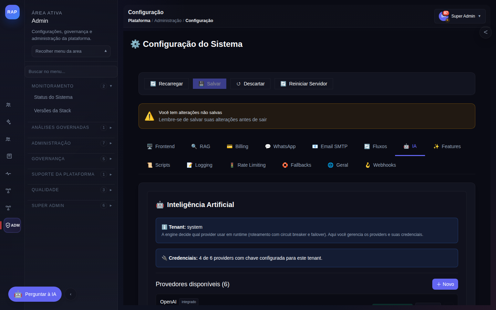
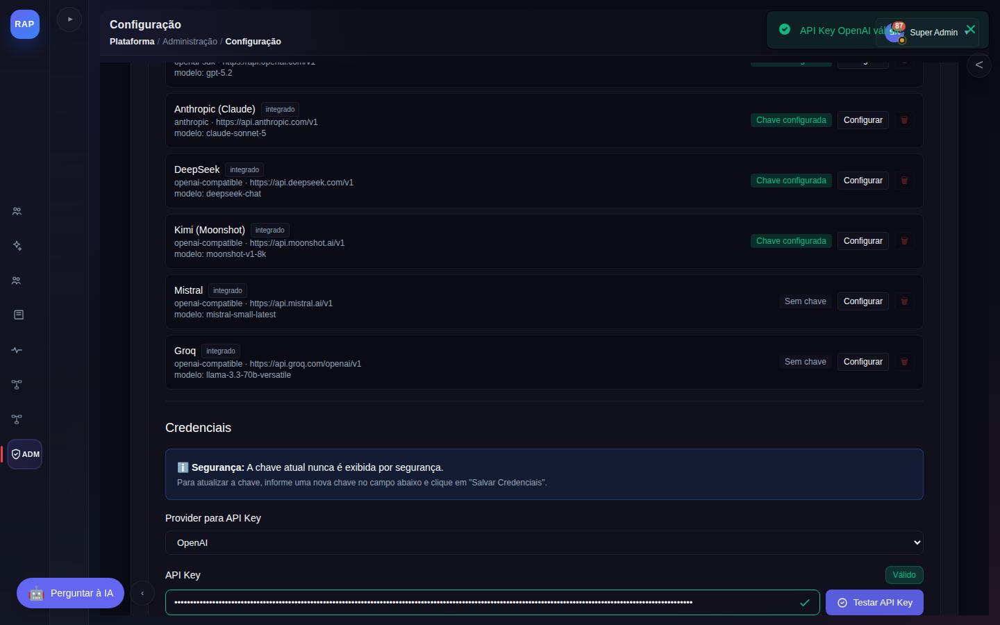
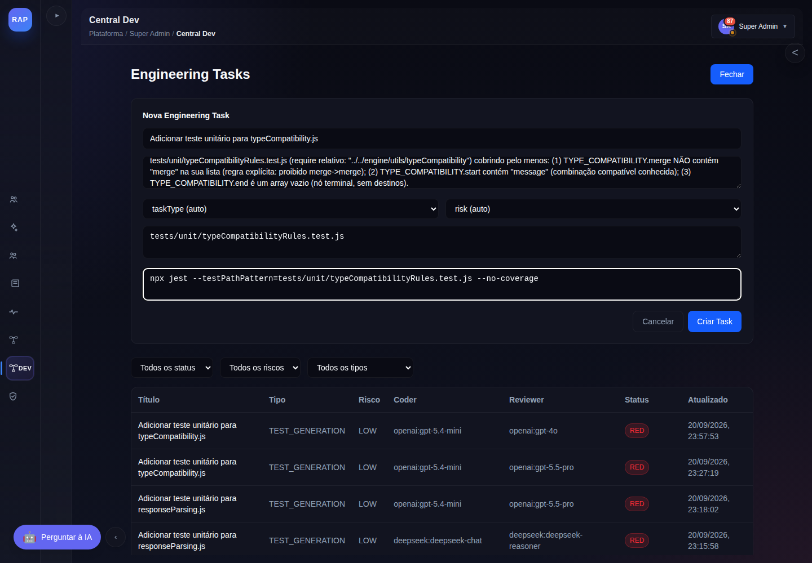
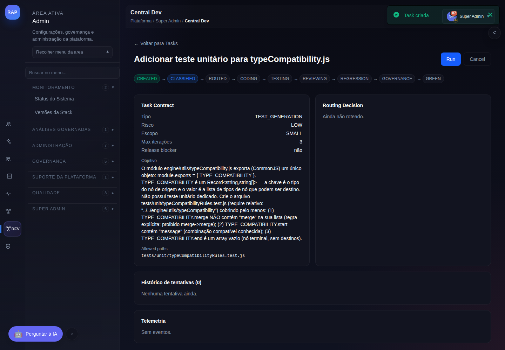
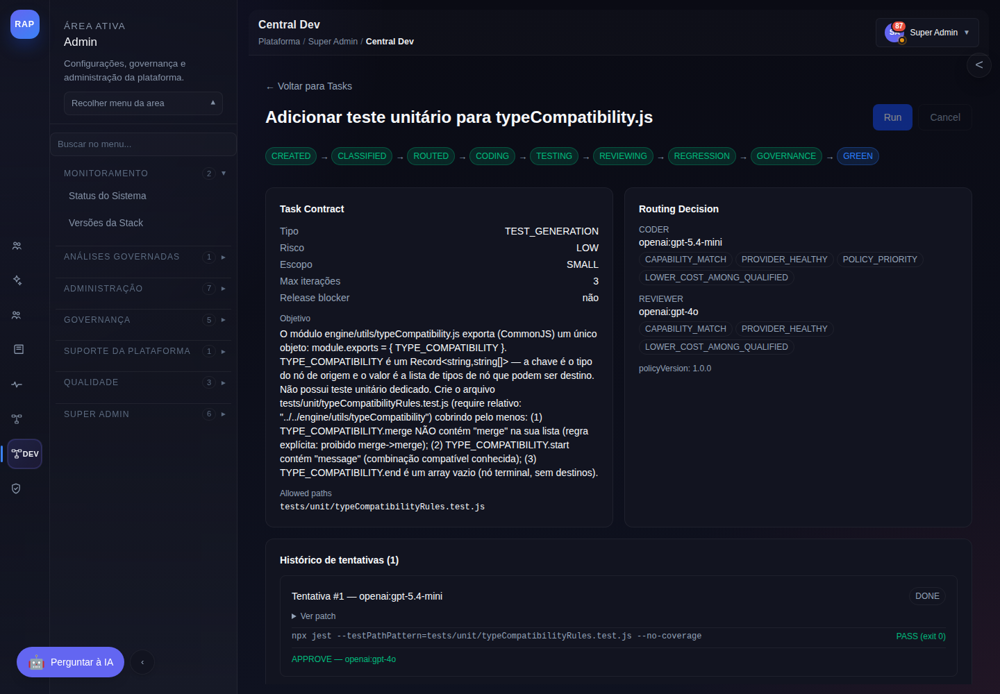
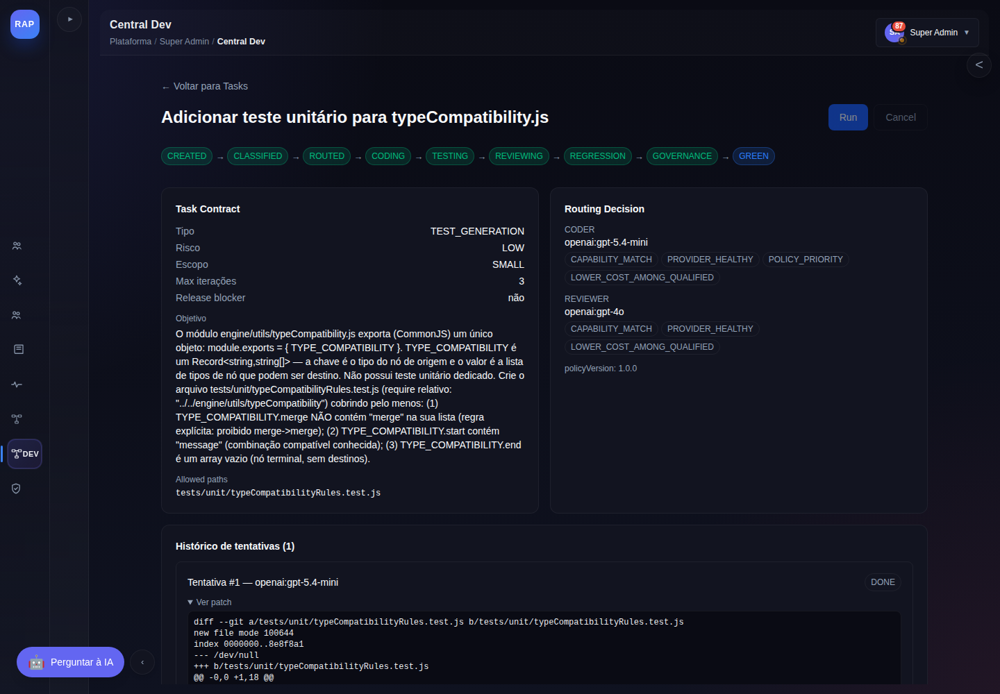
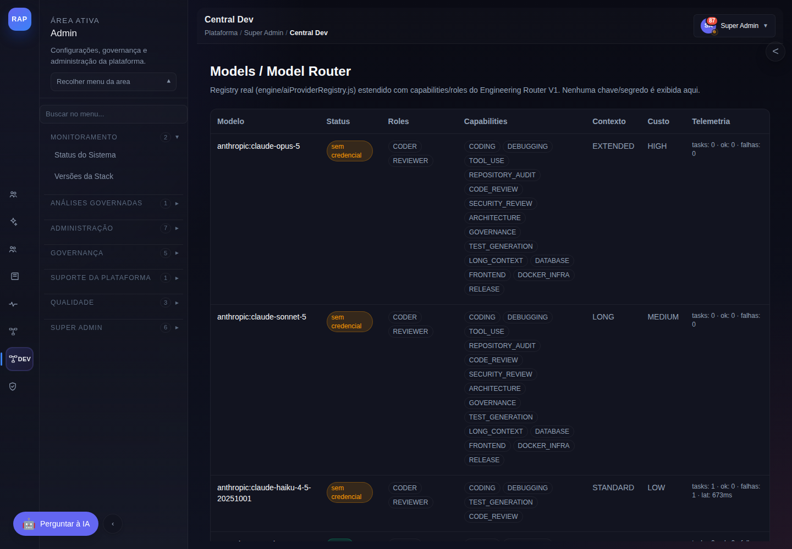
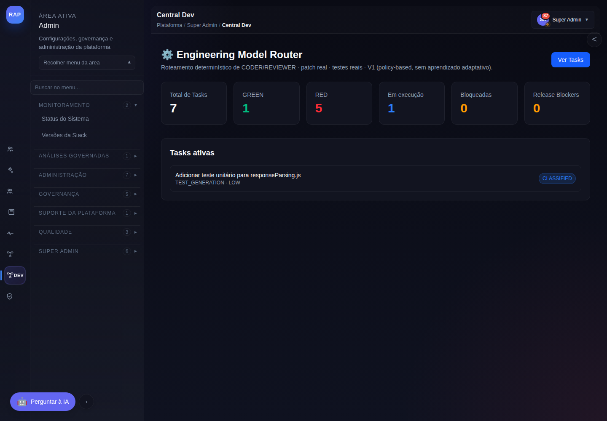
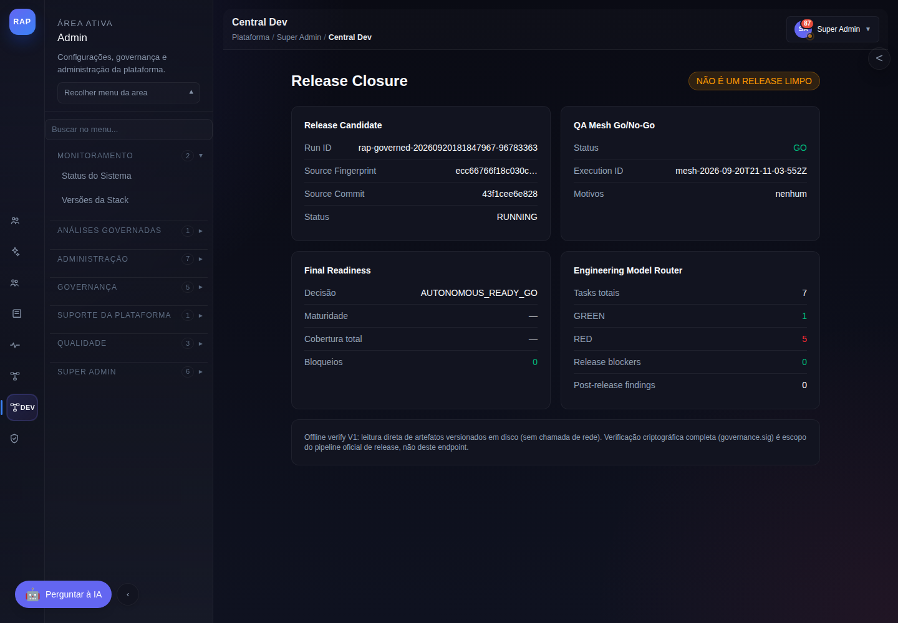

# Manual de Utilização — Engineering Model Router V1

Guia prático, com capturas de tela reais e exemplos realistas, de como configurar e operar o
Engineering Model Router V1. Todas as imagens deste manual foram capturadas de uma execução
real da plataforma — nenhuma é mockup: as chamadas de IA, os testes e as decisões de
roteamento aconteceram de verdade contra provedores externos reais.

Para a arquitetura interna, ver `ENGINEERING_MODEL_ROUTER_ARCHITECTURE.md`. Para o modelo de
segurança, ver `ENGINEERING_MODEL_ROUTER_SECURITY.md`. Este documento é só o "como usar".

## 1. Pré-requisito: configurar credenciais de IA

O Router reutiliza a tela de configuração de IA que já existe no RAP
(`/config?tab=ai`) — não há uma tela de credenciais separada para o Router. Um usuário
`super_admin` pode configurar credenciais em nome de qualquer tenant acrescentando
`?tenant=<id>` à URL; o Router usa por padrão o tenant interno `system`
(configurável via `ENGINEERING_ROUTER_TENANT_ID`, ver `ENGINEERING_MODEL_ROUTER_OPERATIONS.md`).

Acesse **`/config?tenant=system&tab=ai`**:



Selecione o provider, cole a API key real no campo, clique em **Testar API Key** (isso faz uma
chamada real e barata ao provedor — nunca aceite uma credencial sem testar) e só depois em
**Salvar Credenciais**:



Repita para cada provider que quiser habilitar. O resumo no topo da aba mostra quantos
providers têm chave configurada para aquele tenant:


**Atenção real observada em produção**: "chave configurada" não significa "conta com saldo".
Ao rodar o pilot desta missão, duas credenciais pré-existentes (Anthropic, DeepSeek) estavam
sintaticamente válidas mas sem crédito na conta do provedor — o Router corretamente reportou
`PROVIDER_UNAVAILABLE` em vez de fingir sucesso (ver §5). Recomenda-se testar periodicamente e
remover/atualizar credenciais que passem a falhar.

## 2. Onde o Router aparece no menu

Menu lateral → **Central Dev** → **Engineering**, com quatro sub-itens: Overview, Tasks,
Models/Router, Release Closure (a quinta tela, Task Detail, é acessada a partir de Tasks).
Toda a área é `DEVELOPMENT`-only — um usuário classificado como `PRODUCTION` não vê o menu e,
mesmo acessando a URL diretamente, recebe `403 classification_required` do backend.

## 3. Criando uma Engineering Task

Vá em **Tasks** e clique em **+ Nova Task**. Preencha:

- **Título**: curto, descritivo.
- **Objetivo**: quanto mais preciso, melhor — o CODER só vê o que estiver no contexto (arquivos
  dentro de `allowedPaths` + o texto do objetivo). Se a tarefa depende de um módulo que o CODER
  não vai poder editar (só ler/entender), descreva seu comportamento exato no objetivo.
- **taskType/risk**: pode deixar em "auto" — o classifier determinístico infere a partir do
  objetivo e dos `allowedPaths` (ex.: um caminho em `scripts/governance/` vira `GOVERNANCE`
  automaticamente). Se preencher, o valor explícito nunca é sobrescrito.
- **allowedPaths**: um caminho (ou glob) por linha — é o único lugar onde o patch pode escrever.
  Qualquer tentativa de tocar outro arquivo é rejeitada antes de aplicar (`PATCH_OUTSIDE_ALLOWED_SCOPE`).
- **testCommands**: um comando por linha — a autoridade de PASS/FAIL. Precisa estar na allowlist
  (`npm test`, `npm run test:*`, `npx jest ...`, `node scripts/...`, `git status`/`diff`).

Exemplo real usado no pilot desta missão:

```
Título:      Adicionar teste unitário para typeCompatibility.js
Objetivo:    O módulo engine/utils/typeCompatibility.js exporta (CommonJS) um único objeto:
             module.exports = { TYPE_COMPATIBILITY }. TYPE_COMPATIBILITY é um
             Record<string,string[]> — a chave é o tipo do nó de origem e o valor é a lista de
             tipos de nó que podem ser destino. Não possui teste unitário dedicado. Crie o
             arquivo tests/unit/typeCompatibilityRules.test.js (require relativo:
             "../../engine/utils/typeCompatibility") cobrindo pelo menos:
             (1) TYPE_COMPATIBILITY.merge NÃO contém "merge" na sua lista;
             (2) TYPE_COMPATIBILITY.start contém "message";
             (3) TYPE_COMPATIBILITY.end é um array vazio.
taskType:    TEST_GENERATION (auto)
risk:        LOW (auto)
allowedPaths:   tests/unit/typeCompatibilityRules.test.js
testCommands:   npx jest --testPathPattern=tests/unit/typeCompatibilityRules.test.js --no-coverage
```



A lista de tasks embaixo do formulário já mostra, para cada uma, o CODER e o REVIEWER
realmente selecionados e o status — inclusive o histórico real de tentativas RED desta mesma
missão antes de chegar a GREEN (ver §5, é honesto por design: nada é escondido).

Via API (equivalente ao formulário):

```bash
curl -X POST http://localhost:3001/engineering/tasks \
  -H "Authorization: Bearer $TOKEN" \
  -H "Content-Type: application/json" \
  -d '{
    "title": "Adicionar teste unitário para typeCompatibility.js",
    "objective": "...",
    "taskType": "TEST_GENERATION",
    "risk": "LOW",
    "allowedPaths": ["tests/unit/typeCompatibilityRules.test.js"],
    "testCommands": ["npx jest --testPathPattern=tests/unit/typeCompatibilityRules.test.js --no-coverage"],
    "maxIterations": 3
  }'
```

Ao criar, a task já vem classificada (estado `CLASSIFIED`):



## 4. Rodando a task

Na Task Detail, clique em **Run** (ou `POST /engineering/tasks/:id/run`). A resposta é
imediata (`202 Accepted`, fire-and-forget) — o processamento real (chamadas de LLM, aplicação
de patch, execução de teste) roda em segundo plano. Acompanhe recarregando a página ou fazendo
polling em `GET /engineering/tasks/:id`.

```bash
curl -X POST http://localhost:3001/engineering/tasks/<id>/run -H "Authorization: Bearer $TOKEN"
# {"taskId":"...","status":"ACCEPTED"}
```

## 5. Lendo o resultado

Quando termina, a Task Detail mostra a trilha completa do pipeline, a decisão de roteamento
real (com `reasonCodes` estruturados, nunca texto do modelo), o patch gerado, o resultado do
teste determinístico e a decisão do reviewer:



Neste exemplo real: o CODER (`openai:gpt-5.4-mini`, mais barato entre os qualificados) gerou o
patch; `TESTING` rodou `npx jest ... --testPathPattern=tests/unit/typeCompatibilityRules.test.js`
de verdade dentro de um workspace isolado (`git worktree`) e obteve `exit code 0`; o REVIEWER
(`openai:gpt-4o` — um modelo diferente do coder, escolhido porque é o único outro qualificado
com a capability `CODE_REVIEW`) aprovou sem findings. O patch pode ser expandido:



**O arquivo de teste gerado nunca tocou o repositório principal** — ele existiu só dentro do
workspace isolado durante a execução e foi descartado ao final (`git worktree remove`). Isso é
intencional: o Router produz evidência de que um patch funciona, mas a integração ao branch
principal segue o fluxo oficial do time, fora do escopo do Router V1.

### O caminho real até o GREEN (histórico honesto de troubleshooting)

Esta mesma missão expõe, de propósito, o processo real de chegar a um GREEN — a lista de Tasks
mostra várias tentativas anteriores em `RED` antes da que funcionou, cada uma com sua própria
causa raiz real, todas registradas sem serem escondidas ou apagadas:

1. Um provider tinha credencial configurada mas **sem crédito na conta** — o Router reportou
   `PROVIDER_UNAVAILABLE` (mensagem real do provedor: *"Your credit balance is too low"*).
2. Um modelo mapeado no capability registry (`gpt-5.5-pro`) **não existia mais como modelo de
   chat real** na API — a chamada retornou `404`. Corrigido adicionando um modelo real
   confirmado (`gpt-4o`) como reviewer alternativo.
3. O CODER gerou uma resposta cujo `diff` continha, dentro do próprio código de teste, um
   exemplo de string JSON — o escaping de aspas internas quebrou o `JSON.parse` do envelope
   externo. Corrigido com um reparador de fallback (`repairCoderResponse`).
4. O CODER declarou `18` linhas no cabeçalho de um hunk mas só escreveu `16` — erro clássico de
   contagem de LLMs gerando diff — e `git apply` rejeitava o patch inteiro por isso, mesmo com
   o conteúdo perfeitamente correto. Corrigido recalculando a contagem real do hunk antes de
   aplicar (`hunkNormalizer.normalizeHunkHeaders`).

Nenhuma dessas falhas foi escondida ou contornada fingindo sucesso — cada uma ficou registrada
como uma task `RED` real, com a causa exata em `last_error`/`error` de cada tentativa, e as
robustezes que elas motivaram (itens 3 e 4) agora fazem parte do Router para qualquer task
futura.

## 6. Consultando os modelos disponíveis

Em **Models / Router**, cada modelo mapeado mostra seu status real (nunca uma suposição):



`sem credencial` significa que não há chave salva para aquele provider neste tenant — é
diferente de `unhealthy` (credencial existe, mas o circuit breaker abriu por falhas reais) e de
`ready` (qualificado e saudável). A telemetria (`tasks`, `ok`, `falhas`, `lat`) é somada a
partir de eventos reais — nunca projetada ou estimada.

## 7. Overview e Release Closure

**Overview** dá a visão consolidada (totais por status, tasks ativas):



**Release Closure** cruza o estado do Engineering Router com os artefatos de governança reais
do RAP (`governance/.current-run.json`, `qa-mesh/go-no-go-report.json`,
`governance/final-readiness-report.json`) — nunca declara um release limpo se qualquer um
desses artefatos faltar ou não indicar GO/PASS:



## 8. Cancelando uma task

Enquanto não estiver em estado terminal (`GREEN`/`RED`/`BLOCKED`/`CANCELLED`), qualquer task
pode ser cancelada pelo botão **Cancel** ou `POST /engineering/tasks/:id/cancel`. Cancelar uma
task que já está rodando (chamada de LLM em andamento) é seguro — o loop trata a transição de
estado concorrente sem lançar exceção.

## 9. Referência rápida de API

| Rota | Uso |
|---|---|
| `GET /engineering/overview` | Totais e tasks ativas |
| `GET /engineering/tasks` | Lista (filtros `status`, `risk`, `taskType`) |
| `POST /engineering/tasks` | Cria (classifica automaticamente) |
| `GET /engineering/tasks/:id` | Task Contract + routing decision + status |
| `POST /engineering/tasks/:id/run` | Dispara execução (202, fire-and-forget) |
| `POST /engineering/tasks/:id/cancel` | Cancela |
| `GET /engineering/tasks/:id/attempts` | Histórico de tentativas |
| `GET /engineering/tasks/:id/tests` | Resultados de teste por tentativa |
| `GET /engineering/tasks/:id/reviews` | Decisões do reviewer por tentativa |
| `GET /engineering/tasks/:id/telemetry` | Tokens/latência/custo por chamada |
| `GET /engineering/models` | Registry + status real + telemetria acumulada |
| `GET /engineering/router/decision/:taskId` | Classificação + routing decision isolados |
| `GET /engineering/release-closure` | Cruzamento com governança real |

Todas exigem `Authorization: Bearer <token>` de um usuário `DEVELOPMENT` (ex.: `super_admin`).
