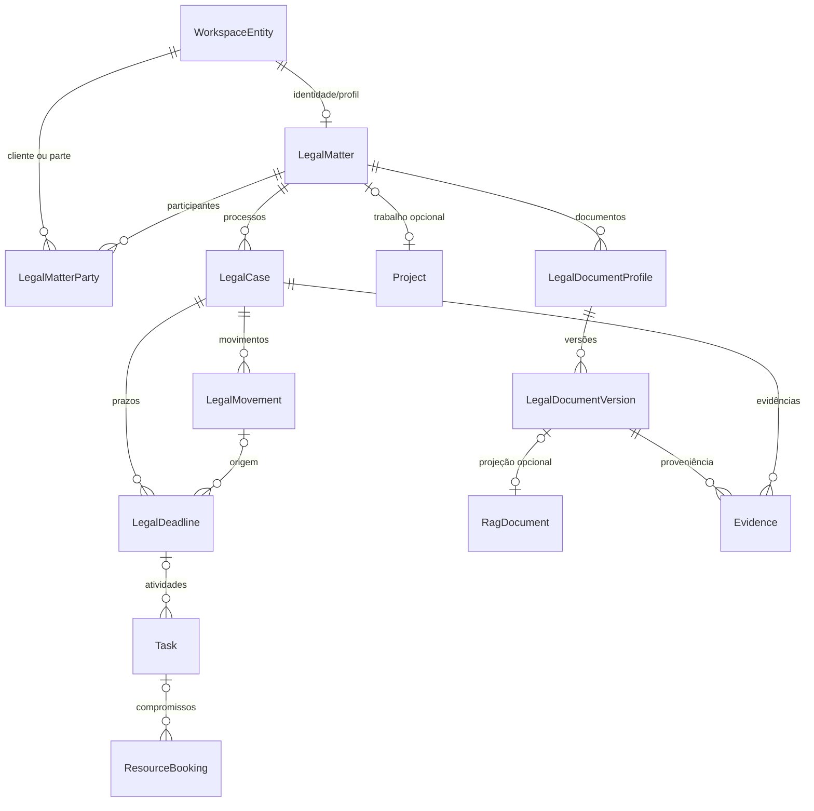

# LEGAL — modelo de domínio proposto sobre o RAP

Data: 2026-10-05. **Discovery; nenhuma entidade, migration ou API Legal foi criada.** Os nomes `Legal*` abaixo são conceitos/propostas, não models existentes. O inventário completo de 213 models, 158 migrations Umzug, 2 SQLs avulsos e 11 aliases está em [_evidence/database-inventory.md](_evidence/database-inventory.md). As verificações executadas constam no relatório consolidado desta análise; um teste localizado não equivale a teste aprovado nem a prova em PostgreSQL vivo.

## Decisão de composição

Legal entra como domínio do mesmo tenant e do mesmo Workspace. Cliente, usuário, contato, conversa, tarefa, arquivo, vetor, execução e auditoria continuam no core RAP. Processo judicial e chamado de atendimento têm semânticas diferentes: o `Case` atual é um `Ticket`, explicitamente documentado no próprio código de [caseService.js](../../api/services/caseService.js):2-9. Não transformar `Ticket.status`, `queue` ou `context` em lifecycle judicial.

O assunto jurídico (`LegalMatter`) pode existir sem processo judicial, chamado de atendimento, Project ou RAG. Um assunto pode relacionar vários processos, clientes/partes, conversas, atividades e documentos. `Project` pode organizar trabalho, mas deve ser uma relação opcional: não é a identidade do cliente nem o cadastro judicial.

O menor delta funcional recomendado é: perfil jurídico de assunto; cadastro processual; movimentações; estado de prazo; metadados/versionamento documental que o core ainda não oferece. **Não aprovar automaticamente nove novos models só porque o briefing lista nove nomes.** `LegalTask` reutiliza `Task`; `LegalEvidence` reutiliza `Evidence` e referências a artefatos; precedente e minuta começam como tipos documentais com contratos específicos.

## O que existe de fato

| Conceito | Código/model/DDL real | Serviço/endpoint real | Limite observado / teste localizado |
|---|---|---|---|
| Pessoa/cliente CRM persistido | [MarketingLead.js](../../api/db/models/MarketingLead.js):21, tabela `marketing_leads`, `tenant_key`, atributos JSONB, índices por e-mail/telefone/external_id; [WorkspaceEntity.js](../../api/db/models/WorkspaceEntity.js):19, tabela `workspace_entities`, `tenant_id` STRING | [marketingService.js](../../api/services/marketing/marketingService.js):226 `upsertLead`, :438 `listLeads`, :458 `getLeadById`, :470 `updateLead`; [marketing/routes.js](../../api/modules/marketing/routes.js):25-27; [WorkspaceEntityService.js](../../api/services/workspace/WorkspaceEntityService.js):67 `createEntity`, :81 `getOrCreateEntityFromContact`, :173 `linkEntityToLead` | Não existe model `Contact`/`Account`. [crm/routes.js](../../api/modules/crm/routes.js):23-29 usa Map; POST de accounts :192 e contacts :273 não escreve DB. GET contacts :220 lê MarketingLead e :228 recorre ao Map. [marketingService.coercion.test.js](../../tests/unit/marketingService.coercion.test.js):114 testa persistência de atribuição com mocks. |
| Identidade externa→cliente core | [IntegrationObjectLink.js](../../api/db/models/IntegrationObjectLink.js), [WorkspaceEntityLink.js](../../api/db/models/WorkspaceEntityLink.js):15 | [memberImporter.js](../../api/services/integration/importers/memberImporter.js):136/168/184 compõe MarketingLead → WorkspaceEntity → AccessSubject | Prova de reutilização já presente numa vertical; o importador atual tem `verticalProfile: 'fitness'`:189, não deve ser copiado como cliente jurídico. [integrationHub.test.js](../../tests/unit/integrationHub.test.js) e [integrationAdversarial.test.js](../../tests/unit/integrationAdversarial.test.js). |
| Project/trabalho | [Project.js](../../api/db/models/Project.js):17 e [ProjectItem.js](../../api/db/models/ProjectItem.js):17; [20260423000001-create-project-management.js](../../api/db/migrations/20260423000001-create-project-management.js):7 | [projectManagementService.js](../../api/services/projectManagement/projectManagementService.js):236 `requireProject` filtra `id + tenant_id`; [project-management/routes.js](../../api/modules/project-management/routes.js):19-51, montado por [domain-operations/routes.js](../../api/modules/domain-operations/routes.js):198 | Tenant de Project é UUID nullable; children escopados pelo pai, sem tenant direto. `listProjects`:436 chama `ensureFixture`:305 e grava demo/itens no GET do tenant vazio. [projectManagementService.test.js](../../api/services/__tests__/projectManagementService.test.js):32/60 cobre KPI e nome, não isolamento completo ou ausência de auto-seed. |
| Case de atendimento | [Ticket.js](../../api/db/models/Ticket.js):21, `tenant_key`; [CaseConversation.js](../../api/db/models/CaseConversation.js):25; [20260827000002-create-case-conversations.js](../../api/db/migrations/20260827000002-create-case-conversations.js) | [caseService.js](../../api/services/caseService.js):112 `createCaseFromConversation`; [cases/routes.js](../../api/modules/cases/routes.js):22 capability `caseManagement`, :57/77 leitura | Reutilizar comunicação/solicitação de atendimento e link opcional com assunto; não chamar processo judicial de Ticket. [caseManagement.test.js](../../tests/unit/caseManagement.test.js):198/294/310 cobre cross-tenant com mocks. |
| Atividade persistida | [Task.js](../../api/db/models/Task.js):13, `tenant_id`, `entity_id`, `ticket_id`, `project_id`, `conversation_id`, `due_date`; [20260429100000-evolve-workspace-production-core.js](../../api/db/migrations/20260429100000-evolve-workspace-production-core.js):19 | [WorkspaceOperationsService.js](../../api/services/workspace/WorkspaceOperationsService.js):37 `createTask`, :60 `listTasks`; [workspace.routes.js](../../api/modules/workspace/workspace.routes.js):26-27 | `/api/tasks` usa outra persistência: [tasksService.js](../../api/services/tasksService.js):11/45/51 array JSONB em `tenant_settings.tasks`. [workspaceCore.test.js](../../api/services/__tests__/workspaceCore.test.js):44 testa criação/link com mocks. Não existe update/complete da Task relacional nesse serviço. |
| Agenda/recursos persistidos | [Resource.js](../../api/db/models/Resource.js):9; [ResourceAvailability.js](../../api/db/models/ResourceAvailability.js):9; [ResourceBooking.js](../../api/db/models/ResourceBooking.js):9; migration acima :57/68/81 | [WorkspaceOperationsService.js](../../api/services/workspace/WorkspaceOperationsService.js):106/118/155; [workspace.routes.js](../../api/modules/workspace/workspace.routes.js):32-36 | Booking é recurso/intervalo, não prazo judicial nem calendário completo. Criação aceita IDs relacionados sem conferir tenant; não há FK na migration. Agenda usada por Cognitive Core é [scheduleService.js](../../api/services/scheduleService.js):39 Map, não `Schedule` DB. |
| Jobs temporizados | [Schedule.js](../../api/db/models/Schedule.js):23 `schedules`; [ExecutionJob.js](../../api/db/models/ExecutionJob.js), `execution_jobs` | [schedulerService.js](../../api/services/schedulerService.js):35 `tickScheduler`; [startWorkers.js](../../api/runtime/startWorkers.js):94-96 inicia; [executionQueueService.js](../../api/services/executionQueueService.js):87 `enqueueJob`, :169 `claimNextJobs` | `Schedule` agenda jobs por intervalo, não reuniões. Scheduler ignora erro de enqueue :78 e avança `next_run_at`:84-87; pode perder alerta. [schedulerService.coercion.test.js](../../tests/unit/schedulerService.coercion.test.js) testa coerção, não entrega após DB outage. |
| Documento/conteúdo/binário | [RagDocument.js](../../api/db/models/RagDocument.js):21, `permissions/domain/classification/sensitivity`; [RagDocumentFile.js](../../api/db/models/RagDocumentFile.js):24/43 binário PostgreSQL | [ragDocumentsService.js](../../api/services/ragDocumentsService.js):59 `requireTenantScope`; [ragCoreRoutes.js](../../api/modules/rag-documents/rag/ragCoreRoutes.js):21/63/129; [ragIngestionRoutes.js](../../api/modules/rag-documents/rag/ragIngestionRoutes.js):48 upload | Não existe model genérico `Document` nem versões de peças jurídicas. Conteúdo original e chunks são distintos. ACL de leitura direta confirmada como blocker em [LEGAL_RAG_REVIEW.md](LEGAL_RAG_REVIEW.md). [ragFileIntegration.test.js](../../tests/integration/ragFileIntegration.test.js) e [ragDocumentsService.coercion.test.js](../../tests/unit/ragDocumentsService.coercion.test.js). |
| Storage/artefato | [RuntimeArtifact.js](../../api/db/models/RuntimeArtifact.js):23 `sha256`, `storage_key`, `run_id`, `source_fingerprint`, `immutable`; [artifactStore.js](../../lib/artifactStore.js):283 backend PostgreSQL, :341 `writeBlob`; [blobStore.js](../../lib/blobStore.js):20/44 storage content-addressed | `createArtifactStore`:505 escolhe backend, :506 default filesystem; reads/writes no backend Postgres filtram tenant | Reusar hash/blob/storage, exigindo backend PostgreSQL e tenant explícito para dados legais. Hash não prova assinatura, retenção ou imutabilidade jurídica. [artifactStorePostgres.test.js](../../tests/unit/artifactStorePostgres.test.js). |
| Evidência operacional | [Evidence.js](../../api/db/models/Evidence.js):21 `source_ref`, anexos, atores, `occurred_at`, idempotência tenant-scoped; [EventLedger.js](../../api/db/models/EventLedger.js):23 causal/correlation/source/run | [evidenceService.js](../../api/services/evidenceService.js):127 `buildEvidenceRecord`, :205 `indexEvidence`; [evidenceTimelineService.js](../../api/services/evidenceTimelineService.js):251 `getTimeline`; [evidence/routes.js](../../api/modules/evidence/routes.js):94/124 | Extrator heurístico/score `confidence` não é autenticidade de prova judicial. Endpoint só exige auth+tenant, sem ACL por assunto. [evidenceService.test.js](../../tests/unit/evidenceService.test.js):101 testa idempotência; [evidenceRoutes.test.js](../../tests/integration/evidenceRoutes.test.js). |
| Entrega/alerta | [NotificationDelivery.js](../../api/db/models/NotificationDelivery.js):17; [20260326110000-create-notification-deliveries.js](../../api/db/migrations/20260326110000-create-notification-deliveries.js) | [notificationService.js](../../api/services/notificationService.js):362 `queueNotification`, :416 `performChannelSend`; job dispatch em [executionQueueService.js](../../api/services/executionQueueService.js):549 | `internal` resulta `SKIPPED/internal_noop`:421-422; WhatsApp :434 usa serviço global sem tenant; SMTP :136 lê config global. Consentimento/aprovação jurídica não presente. [notificationService.test.js](../../tests/unit/notificationService.test.js):118/246/285 testa fila/email/stub com mocks. |

CRM, Workspace, Case, Evidence, taskRouter e supportDebugRouter estão montados em [routeRegistry.js](../../api/app/routeRegistry.js):17/45/69/70/79/81; [registerRoutes.js](../../api/app/registerRoutes.js):266-269 executa os mounts. Assim, Maps de CRM/agenda não são apenas fixtures desligadas.

## Mapeamento dos nove conceitos solicitados

| Conceito Legal | Decisão futura | Delta mínimo proposto | Status do domínio hoje |
|---|---|---|---|
| `LegalMatter` | Compor `WorkspaceEntity` como identidade navegável e cliente(s) core; Project opcional | Perfil relacional `legal_matters` ligado à entity, área jurídica, responsável, lifecycle; relações de partes/clientes e ACL por assunto. Não guardar assunto inteiro em `WorkspaceEntity.metadata`. | EXTEND; sem model jurídico. |
| `LegalCase` | Cadastro judicial separado, filho de assunto; relacionar Ticket só para atendimento | `legal_cases`: identificador processual normalizado, tribunal/sistema/origem, classe/competência, nível de sigilo, estado, conexão externa e fonte verificável. | MISSING. |
| `LegalMovement` | Evento de domínio conectado ao EventLedger/IntegrationInboundEvent existentes | Registro relacional imutável com case, ID externo, tipo, texto/fonte, datas de publicação/ciência quando informadas, hash de origem e ingest; idempotência de fonte, correções como revisões. EventLedger distribui evento; não substitui o cadastro pesquisável de movimentos. | MISSING. |
| `LegalDocument` | Especializar documentos/storage existentes | Metadata relacional de vínculo matter/case, tipo, confidencialidade e versão; reutilizar RagDocumentFile ou blob+RuntimeArtifact para bytes. RAG é projeção indexada opcional. Original não deve desaparecer ao remover índice RAG. | EXTEND; ACL direta bloqueada. |
| `LegalDeadline` | Compor `Task`, agenda/recursos e jobs, sem confundir data sugerida com prazo | Registro relacional de estado `DETECTED/ESTIMATED/CONFIRMED`, fundamento, versão do calendário, timezone, fonte, conferente humano e confirmação ligada à versão. | MISSING; controle de confirmação é BLOCKER de ativação. |
| `LegalPrecedent` | Documento tipado + RAG com proveniência | Perfil/verificação de precedente: órgão, referência, fonte/URL, versão/data consultada, trecho identificável e hash. Nenhuma coleção nova de embeddings. Tabela própria somente se relações/query/estado de verificação exigirem. | EXTEND; verificação jurídica inexistente. |
| `LegalDraft` | Documento tipado/versionado + workflow de revisão/aprovação | Tipo `draft`, versões, origem/inputs/model/prompt refs, autor/revisor, evidências e decisão sobre versão exata. Nunca implicar assinatura ou protocolo. | EXTEND; workflow durable HITL atual exige correção. |
| `LegalTask` | Alias/capability de `Task` existente | Extensão de vínculo com matter/case/deadline (preferir relações tipadas); consolidar `/api/tasks` JSONB e Workspace Task; estados e updates do core. Nenhum segundo CRUD de tarefas. | REFACTOR + EXTEND. |
| `LegalEvidence` | Compor Evidence + EventLedger + RuntimeArtifact/document version | Vínculo de origem, versão/hash dos bytes, captura/autor/correlação e cadeia de eventos; sigilo/need-to-know e retention do core. Nenhum segundo Evidence Engine. | EXTEND; integridade e ACL específica UNPROVEN. |

`MISSING` indica semântica jurídica ausente, não ausência do mecanismo de persistência ou do core a reutilizar. A existência de `LegalPrecedent`/`LegalDraft` como termos de negócio não exige automaticamente tabelas separadas.

## Relações e armazenamento — proposta, não schema existente

Todas as entidades `Legal*` do diagrama são propostas; `LegalMatterParty`, `LegalDocumentProfile` e `LegalDocumentVersion` mostram responsabilidades relacionais, não autorização de criar models. Uma versão documental aponta para **um backend de bytes canônico** (RagDocumentFile ou blob+RuntimeArtifact), sem manter cópias divergentes. Extender as estruturas documentais existentes de modo genérico quando o requisito também beneficiar outras verticais.

| Registro futuro | Campos mínimos que não devem virar JSON solto | Relações/índices propostos |
|---|---|---|
| Perfil de assunto | UUID interno, tenant obrigatório, workspace entity, referência do escritório, título, estado, responsável, confidencialidade | UNIQUE(tenant, id), UNIQUE(tenant, workspace_entity_id); índice (tenant, status, responsável); participantes/clientes N:N no tenant. |
| Cadastro processual | UUID interno, tenant, matter, tribunal/sistema, identificador normalizado, sigilo, estado, source connection/link | UNIQUE(tenant, origem, identificador normalizado) quando fonte garantir identidade; mesma referência em outra origem precisa política explícita de reconciliação. Índices (tenant, matter), (tenant, estado). |
| Movimentação | UUID, tenant, case, external event/ref, ocorreu/publicou/ingeriu em, hash/source binding, tipo, conteúdo normalizado | FK composta tenant+case; UNIQUE(tenant, connection/source, external_event_id) ou fingerprint de conteúdo estável quando ID não existir; (tenant, case, publication_at). Datas ausentes permanecem ausentes. |
| Prazo | UUID, tenant, matter/case, movement/document source, estado, suggested_date, confirmed_date, timezone, rule/calendar version, confirmed_by/at, revision, approval/evidence ref | CHECK confirmado ⇒ data + ator + evidência + versão; optimistic concurrency; (tenant, estado, confirmed_date), (tenant, case); unicidade da hipótese por origem/base, sem fundir hipóteses ambíguas. |
| Document metadata/version | UUID, tenant, matter/case, tipo, versão, original bytes ref/hash, status de aprovação, ACL/sensitivity | FK tenant+document/source; UNIQUE(tenant, document_id, version); índices matter/case/tipo; hash verificável dos bytes. |
| Links a Task/Booking/Evidence | Tenant, subject ID, target ID, relação tipada e revisão | FKs compostas ou validação transacional de ambos os lados; nenhum vínculo aceita objeto de outro tenant. WorkspaceEntityLink é navegação/agrupamento, não substitui integridade relacional jurídica. |

Identidade de tenant: `Tenant.id` é UUID e `Tenant.tenant_key` é STRING única ([Tenant.js](../../api/db/models/Tenant.js):24/29/90). Project/TenantSetting usam UUID; WorkspaceEntity/Task usam STRING `tenant_id`; RAG/comunicação/jobs usam STRING `tenant_key`. O serviço de domínio deve resolver **ambos a partir do tenant autenticado** e comparar relações no domínio correto. A convenção futura de Legal deve ser única; a escolha recomendada para integração com RAG/Inbox é `tenant_key` não nullable, resolvida server-side, sem trocar automaticamente o contrato legado de Project. Ao compor Project, usar o UUID real do mesmo Tenant. Não aceitar tenant do payload nem `system/default` por ausência.

Migrations futuras precisarão adicionar unicidade tenant+id aos pais existentes quando FKs compostas exigirem; schemas atuais de Task/Booking não fornecem essa integridade. Soft delete não está declarado no conjunto atual: planejar arquivamento/retention com política explícita e append-only para movimentos/decisões, sem importar `destroy()` de Project para matéria jurídica.

## Prazo: confiança da IA não é confirmação

| Estado proposto | Dados permitidos | Transição/ator | Efeitos permitidos |
|---|---|---|---|
| DETECTED | fonte, trecho, processo/assunto candidato, instante da captura; nenhuma data confirmada | Ingest/ferramenta/IA registra observação | Criar pendência de revisão, sem assumir obrigação externa. |
| ESTIMATED | hipóteses/data estimada, basis, timezone, calendário/versionamento, confiança, ambiguidade | Motor propõe com source refs; humano pode editar hipótese | Alertar “revisão pendente”; não projetar como prazo confirmado em agenda/analytics. |
| CONFIRMED | data separada e decisão humana vinculada à revisão/hash da fonte + calendário | Serviço exige autorização, usuário habilitado, versão vigente e evidência; IA não pode promover estado | Criar/update Task, Booking quando aplicável, jobs e alertas idempotentes. |

Novo movimento, calendário ou documento que muda a base de um prazo confirmado gera revisão e necessidade de reconfirmação; não sobrescreve a confirmação antiga. Casos negados/cancelados/encerrados precisam eventos explícitos e auditoria, mantendo as três categorias de certeza acima separadas do lifecycle operacional.

`scheduleService.updateScheduleStatus('confirm')` ([scheduleService.js](../../api/services/scheduleService.js):118-120) apenas muda campos em memória, sem prova de autoria/base; **não é LegalDeadline.confirm**. `Task.due_date` é uma data de tarefa, não guarda certeza jurídica. `PbxHoliday` ([PbxHoliday.js](../../api/db/models/PbxHoliday.js):4) modela feriados de telefonia por tenant; não há calendário de tribunais, dias úteis jurisdicionais ou suspensão de prazos localizado no escopo de modelos/serviços. Reaproveitar representação de calendário se generalizada e versionada; não tratar o calendário PBX como fonte judicial validada.

A máquina `DETECTED → ESTIMATED → CONFIRMED` e as regras de dias/calendário são requisitos futuros de produto a validar por profissional responsável. Esta análise não afirma regras de contagem jurídica nem inventa feriados.

## JSON/Maps atuais e convergência requerida

- CRM `stores`/Maps e agenda `schedulesByTenant` são estado operacional efêmero em caminhos montados; migrar para os models/serviços já persistidos, sem criar `legal-clients.json` ou `legal-agenda.json`.
- `tenant_settings.tasks` ([tasksService.js](../../api/services/tasksService.js):51-55) já é JSONB no banco, mas atividades deveriam convergir para `tasks` relacional. O read-modify-write do array não oferece a mesma query/concurrency/relação do model Task; não duplicar tarefas para Legal.
- `ProjectItem.origin_context_json`, `ProjectTemplate.template_json`, `RagDocument.metadata`, `IntegrationInboundEvent.payload` são JSONB de contexto/config/fonte no banco. Preservar essa finalidade; não colocar lifecycle, datas confirmadas, relações ou decisões jurídicas só nesses blobs.
- `artifactStore` tem default filesystem e metadados JSON ([artifactStore.js](../../lib/artifactStore.js):99/127/505). Artefato/snapshot/export pode ser arquivo; a autoridade de domínio, aprovação e lineage precisa PostgreSQL, com backend `postgres` configurado e tenant explícito.
- Registries versionados em `config/*.json` são declaração de capacidades/políticas; não são cadastro vivo de clientes/processos. Não migrar configuração estática ao banco só por usar JSON.

## Critérios de aceite do delta de banco

1. Nenhuma pessoa, conversa, tarefa, arquivo ou vetor é duplicado pela vertical; relações apontam para registros core existentes.
2. Restart mantém clientes/agenda/prazos; DB indisponível falha explicitamente. CRM POST/GET/read-by-id e agenda humana/cognitiva consultam a mesma autoridade.
3. Criação de Task/Booking/link em tenant A com IDs reais de B é recusada antes de escrever; nenhuma linha parcial permanece após falha de link.
4. Prazo estimado nunca aparece como confirmado sem decisão humana versionada; concorrência, reprocessamento e fonte revisada não burlam isso.
5. Upload, download, detalhe, busca, vector retrieval e attachment links respeitam tenant, classificação, sensitivity e ACL por assunto; retirar acesso invalida também cache/index/projeção.
6. Falha no enqueue não consome trigger nem avança o prazo silenciosamente; entrega `STUB/SKIPPED` não conta como alerta entregue. Alertas internos precisam entrega real.
7. Migration forward/backward preserva dados, IDs e evidência. Rollback desliga a capability e para novos jobs; não apaga a cadeia de movimentos/decisões para “voltar atrás”.

Testes atuais são pontos de partida (muitos usam mocks); faltam jornadas Legal e provas de isolamento relacional/prazos/retention sobre DB vivo. Não interpretar gates genéricos PASS como certificado da vertical ainda não implementada.
