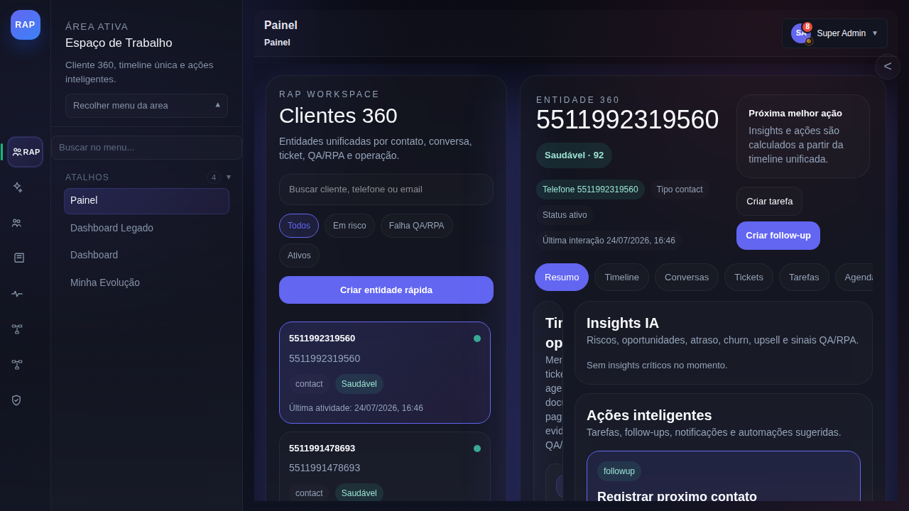
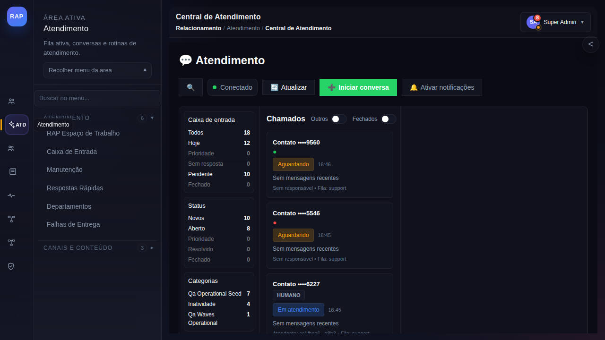
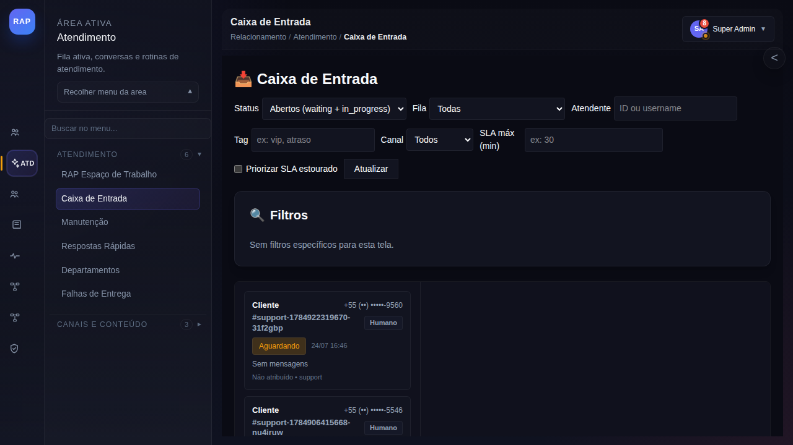
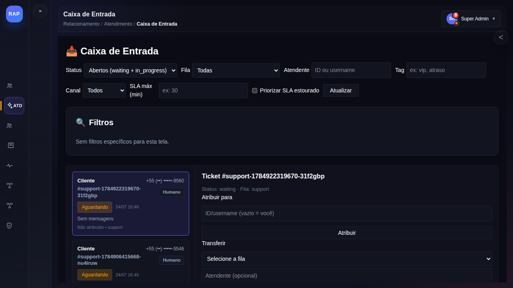
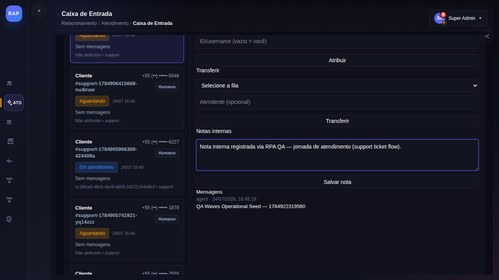
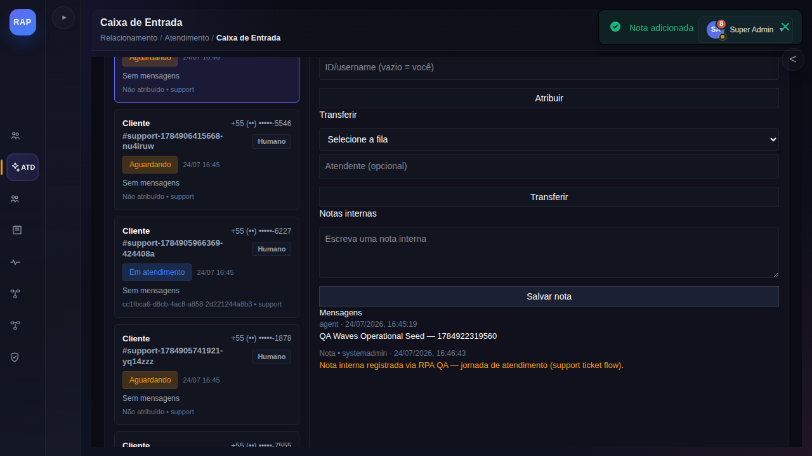

# Manual — Registrar nota interna em um atendimento (Caixa de Entrada)

> Jornada: `support_ticket_flow` (núcleo) · Telas reais capturadas em 24/07/2026 a partir do replay operacional `qa_wave_replay_1784922319709_1ab6vi` (QA Waves, execução GO).
> Base de treinamento: Learning Core `training:qa_wave_replay_1784922319709_1ab6vi` (consultável no Academy/RAG).
> Público: atendentes e supervisores que trabalham na Caixa de Entrada.

## 1. Objetivo

Ao final deste manual você será capaz de:

- abrir a Caixa de Entrada pelo menu Atendimento;
- localizar e selecionar um ticket na lista;
- registrar uma **nota interna** (visível apenas para a equipe, nunca para o cliente);
- confirmar que a nota foi salva.

Tempo de referência da execução real: **~1 minuto**.

## 2. Pré-requisitos

- Usuário autenticado na plataforma (login e senha válidos).
- Perfil com acesso à área **Atendimento** (o item aparece no rail lateral esquerdo).
- Existir ao menos um ticket na Caixa de Entrada.

## 3. Passo a passo

### Passo 1 — Faça login e aguarde o Workspace

Após o login, a plataforma abre automaticamente o **Workspace** (`/workspace`).
Aguarde o carregamento completo da interface: o rail lateral esquerdo (ícones das áreas)
e o menu da área ativa devem estar visíveis.



### Passo 2 — Abra a área Atendimento

No rail lateral esquerdo, clique no ícone **ATD (Atendimento)**.
A área Atendimento abre na **Central de Atendimento** e o menu lateral da área
passa a listar as rotinas de atendimento — incluindo **Caixa de Entrada**
(as seções já abrem expandidas — não é preciso clicar nos títulos).



### Passo 3 — Abra a Caixa de Entrada

No menu lateral, na seção **ATENDIMENTO**, clique em **Caixa de Entrada**.
A lista de tickets é carregada com os filtros no topo:

- **Status** — padrão `Abertos (waiting + in_progress)`;
- **Fila** — filtra por fila de atendimento (ex.: `support`);
- **Atendente** — filtra por ID ou username do responsável;
- **Tag** — filtra por etiqueta (ex.: `vip`, `atraso`);
- **Canal** — filtra pelo canal de origem;
- **SLA máx (min)** e **Priorizar SLA estourado** — controle de prazo;
- **Atualizar** — recarrega a lista a partir do backend.

Cada card de ticket mostra: telefone mascarado do cliente, protocolo (`#support-...`),
modo (`Humano`), status (`Aguardando` / `Em atendimento`), data/hora, prévia da última
mensagem e atribuição atual.



### Passo 4 — Selecione o ticket

Clique no card do ticket desejado. O card fica destacado e o **painel de detalhes**
abre à direita, com o cabeçalho `Ticket #<protocolo>`, status e fila atuais.


### Passo 5 — Localize o bloco Notas internas

No painel de detalhes, role até a seção **Notas internas**.
O mesmo painel também oferece (uso opcional, fora do escopo deste manual):

- **Atribuir para** — atribui o ticket a um atendente (vazio = você);
- **Transferir** — move o ticket para outra fila e/ou atendente;
- **Mensagens** — histórico completo do ticket (mensagens do cliente, do agente
  e notas internas, estas destacadas em cor de alerta).



### Passo 6 — Escreva a nota interna

Clique no campo **"Escreva uma nota interna"** e digite o texto.

Exemplo de preenchimento (dado sintético, seguro para prática):

```text
Cliente relatou instabilidade no acesso ao app desde ontem.
Verificado cadastro e últimas interações; encaminhar para o
nível 2 se o problema persistir após novo teste.
```

Boas práticas:

- registre fatos e decisões, não opiniões;
- inclua o que já foi verificado e o próximo passo esperado;
- lembre-se: a nota é interna — o cliente **não** a vê, mas toda a equipe sim.



### Passo 7 — Salve e confirme

Clique em **Salvar nota**. Duas confirmações devem aparecer:

1. o toast verde **"Nota adicionada"** no canto superior direito;
2. a nota passa a constar na seção **Mensagens**, com o prefixo
   `Nota • <seu usuário>` e destaque em cor de alerta.



Se o toast não aparecer, a nota **não** foi salva — verifique a seção
"Problemas comuns" abaixo.

## 4. Problemas comuns

| Sintoma | Causa provável | Ação |
|---|---|---|
| Não vejo o ícone Atendimento no rail | perfil sem acesso à área | peça a liberação ao administrador |
| Lista de tickets vazia | filtro restritivo ou sem tickets abertos | revise Status/Fila/Atendente e clique em **Atualizar** |
| Botão Salvar nota não reage | campo vazio | escreva o texto da nota antes de salvar |
| Toast de erro ao salvar | falha de comunicação com o backend | tente novamente; persistindo, avise o suporte técnico |

## 5. Referências

- Roteiro de treinamento (formato Learning Core): [treinamento-support-inbox-nota-ui.md](treinamento-support-inbox-nota-ui.md)
- Jornada completa de atendimento (responder ao cliente e encerrar ticket): rota `/support`, área Atendimento → RAP Espaço de Trabalho.
- Dúvidas em linguagem natural: pergunte ao assistente (Academy/RAG) — este manual e o replay da jornada integram a base de conhecimento.
