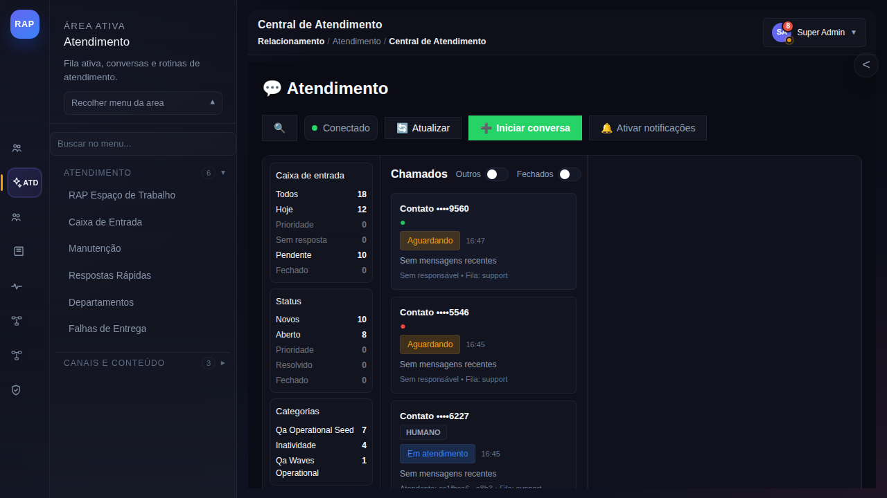
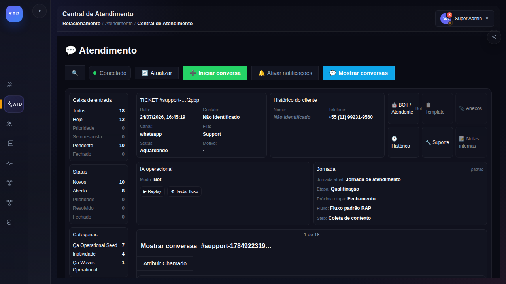
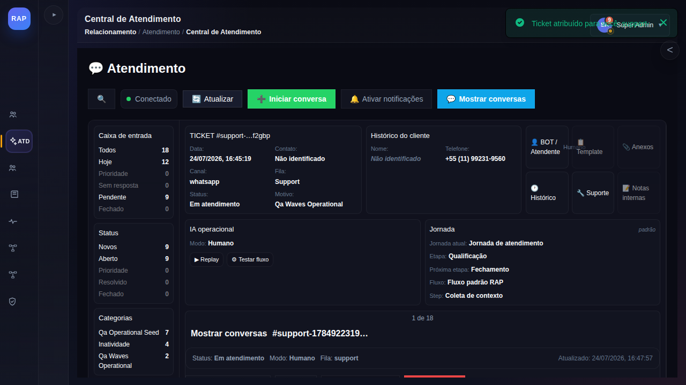
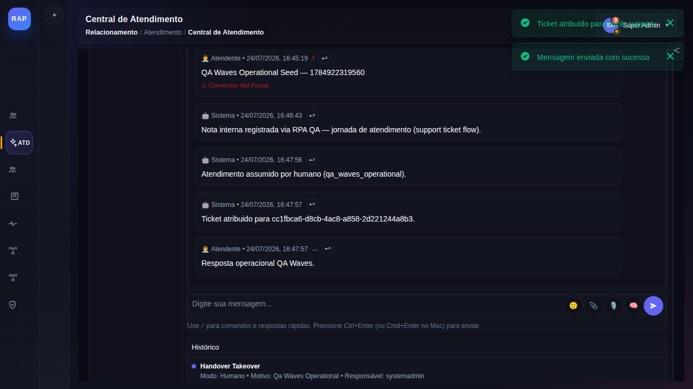
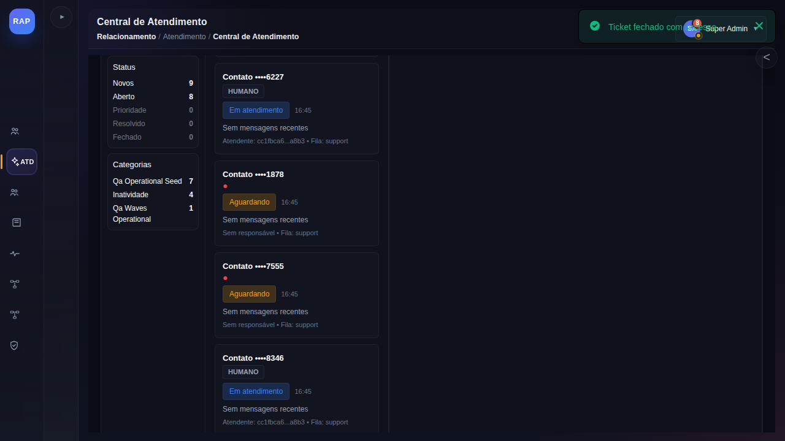
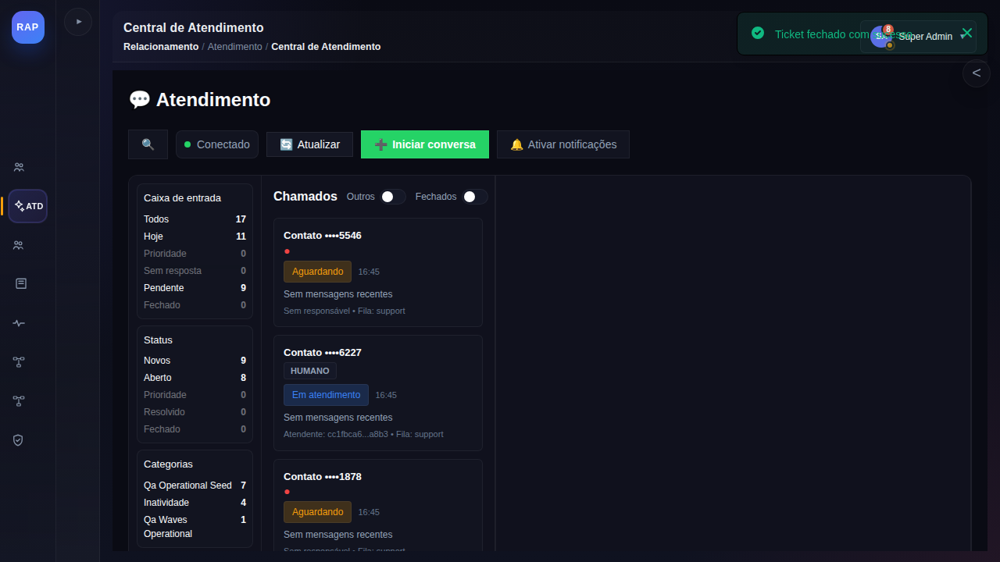

# Manual — Atender um chamado na Central de Atendimento (rota /support)

> Jornada: `support_ticket_flow` (núcleo) · Telas reais capturadas em 24/07/2026 a partir do replay operacional GO `qa_wave_replay_1784922319709_1ab6vi` (QA Waves, execução em browser real).
> Base de treinamento: Learning Core/RAG (jornada `core.support_ticket_flow`).
> Público: atendentes e supervisores.
> Escopo: assumir um chamado, responder ao cliente e encerrar o atendimento. Para notas internas na Caixa de Entrada (`/inbox`), ver o [manual específico](manual-atendimento-nota-interna.md).

## 1. Objetivo

Ao final deste manual você será capaz de:

- abrir a **Central de Atendimento** pelo menu;
- localizar um chamado na lista e abrir o detalhe;
- **assumir** o chamado (takeover: Bot → Humano);
- **responder** ao cliente pelo composer;
- **encerrar** o chamado e confirmar a saída da lista de abertos.

## 2. Pré-requisitos

- Usuário autenticado, com acesso à área **Atendimento** (rail lateral esquerdo).
- Existir ao menos um chamado na fila (visível nos contadores da Caixa de entrada).

## 3. Conhecendo a tela

A Central de Atendimento (`/support`) é o espaço operacional do atendente:

- **Barra superior** — status de conexão (`Conectado`), **Atualizar**, **Iniciar conversa** (novo atendimento manual), **Ativar notificações** e **Mostrar conversas**.
- **Coluna esquerda** — contadores da *Caixa de entrada* (Todos, Hoje, Prioridade, Sem resposta, Pendente, Fechado), por *Status* (Novos, Aberto, Prioridade, Resolvido, Fechado) e por *Categorias*.
- **Chamados** — cards com contato mascarado, status (`Aguardando` / `Em atendimento`), horário, responsável e fila; alternadores **Outros** e **Fechados** filtram a lista.



## 4. Passo a passo

### Passo 1 — Abra a Central de Atendimento

Clique no ícone **ATD (Atendimento)** no rail lateral e, no menu da área,
clique em **Atendimento**. A Central de Atendimento abre com a lista de chamados.

### Passo 2 — Abra o chamado

Clique no card do chamado desejado. O painel de detalhe mostra:

- **TICKET #&lt;protocolo&gt;** — data de abertura, canal (ex.: `whatsapp`), fila e status atual;
- **Histórico do cliente** — nome e telefone (quando identificados);
- **IA operacional** — modo atual (`Bot` ou `Humano`), com ações de *Replay* e *Testar fluxo*;
- **Jornada** — jornada atual, etapa, próxima etapa, fluxo e step em execução;
- **Ações rápidas** — BOT/Atendente, Template, Anexos, Histórico, Suporte e Notas internas.



### Passo 3 — Assuma o chamado

Clique em **Atribuir Chamado**. O sistema registra o *takeover* e a tela confirma:

- toast **"Ticket atribuído para &lt;você&gt;"**;
- status muda de `Aguardando` para **Em atendimento**;
- **IA operacional** muda de modo `Bot` para **Humano** — a partir daí,
  quem responde é você, não o bot;
- o evento fica registrado no **Histórico** (`Handover Takeover`, com motivo e responsável).



### Passo 4 — Responda ao cliente

Com o chamado **Em atendimento**, o composer aparece na conversa:

- digite a mensagem no campo **"Digite sua mensagem..."**;
- use `/` para **comandos e respostas rápidas**;
- envie pelo botão de envio ou com **Ctrl+Enter** (Cmd+Enter no Mac);
- anexos e outros recursos ficam nos ícones ao lado do campo.

Exemplo de primeira resposta (dado sintético, seguro para prática):

```text
Olá! Aqui é da equipe de atendimento. Assumi o seu chamado e
já estou verificando o caso. Em instantes retorno com a solução.
```

Confirmações de envio: toast **"Mensagem enviada com sucesso"** e a mensagem
passa a constar na conversa como **Atendente**, com data/hora.



> Observação: a entrega ao canal do cliente (ex.: WhatsApp) depende do provider
> conectado. Se o envio externo falhar, a plataforma sinaliza o estado na própria
> mensagem — reenvie ou acione o suporte técnico.

### Passo 5 — Encerre o chamado

Concluído o atendimento, clique em **Fechar ticket** (ícone/ação de encerramento
no cabeçalho da conversa). A confirmação vem pelo toast **"Ticket fechado com sucesso"**.



### Passo 6 — Confirme a saída da lista

Clique em **Atualizar**. O chamado encerrado **não aparece mais** na lista
operacional de abertos — ele permanece acessível pelo alternador **Fechados**
e pelo Histórico, para consulta e auditoria.



## 5. Regras importantes

- **Só é possível responder com o chamado assumido** (modo Humano). Se o composer
  não aparece, verifique se o chamado está `Em atendimento` e atribuído a você.
- **Takeover é auditado**: cada assumir/encerrar gera registro de auditoria com
  autor, horário e motivo.
- **Notas internas não são resposta ao cliente**: notas (botão *Notas internas* ou Caixa de Entrada)
  são visíveis só para a equipe; o composer envia mensagem ao cliente.
- **Encerrar é definitivo na fila**: o chamado sai dos abertos; reabrir exige
  nova interação do cliente ou ação administrativa.

## 6. Problemas comuns

| Sintoma | Causa provável | Ação |
|---|---|---|
| Composer não aparece | chamado ainda `Aguardando` (modo Bot) | clique em **Atribuir Chamado** antes de responder |
| Toast de erro ao enviar | falha de backend ou provider desconectado | tente reenviar; verifique a conexão do canal |
| Chamado não sai da lista após fechar | lista desatualizada | clique em **Atualizar** |
| Não vejo o ícone Atendimento | perfil sem acesso à área | peça liberação ao administrador |

## 7. Referências

- Manual da Caixa de Entrada (nota interna, filtros, atribuição): [manual-atendimento-nota-interna.md](manual-atendimento-nota-interna.md) ([PDF](manual-atendimento-nota-interna.pdf))
- Roteiro de treinamento Learning Core: [treinamento-support-inbox-nota-ui.md](treinamento-support-inbox-nota-ui.md)
- Dúvidas em linguagem natural: assistente Academy/RAG — este manual e os replays da jornada integram a base de conhecimento.
